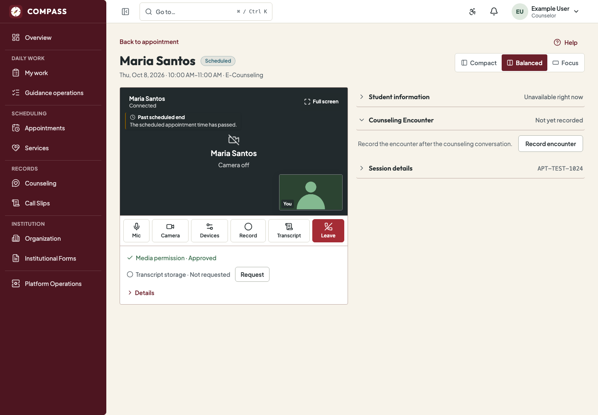
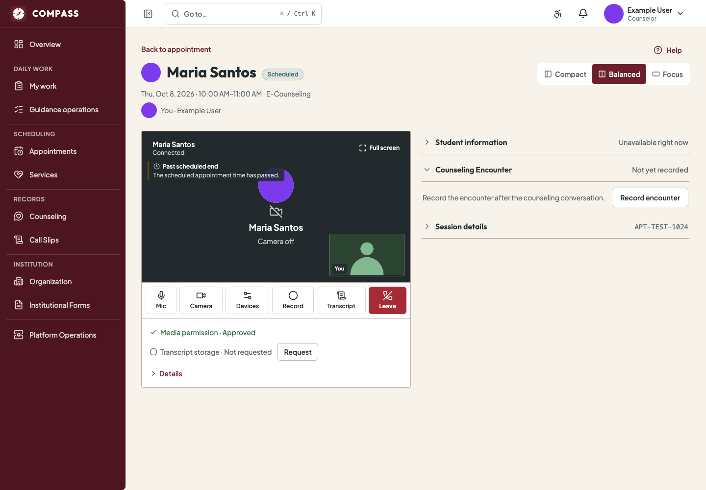
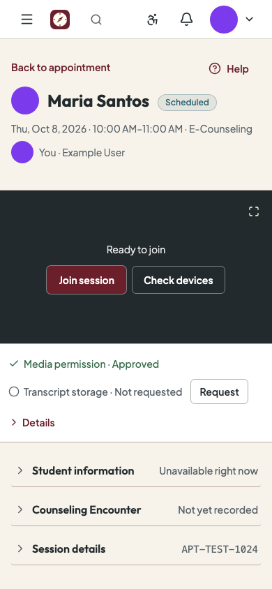

# COMPASS-AVATAR-1 Implementation Report

## Pre-change architecture audit

This baseline was recorded from the `staging` worktree before implementation changes.

### Existing profile-photo architecture

- `User` stores a private object key and `profile_photo_updated_at`; upload processing validates JPEG, PNG, and WebP input, normalizes it to metadata-free WebP, and enforces upload, pixel, dimension, and output limits.
- `profile_photos.py` writes to the configured private `ObjectStorage`, swaps the account reference only after a successful write, and schedules old-object cleanup after commit. `profile_photo_url()` returns the storage provider's short-lived URL.
- The authenticated `/profile/me` API exposes only the current account's photo URL and version timestamp. Upload and removal remain self-service. No public or arbitrary-user photo lookup exists.
- The frontend's `AccountAvatar` is coupled to `UserSummary` and `MyProfileResponse`. It uses `next/image` with `unoptimized`, has a photo-load fallback, and appears in the account menu and own Profile. It offers only top-bar and profile sizes.

### Current identity projections and limitations

- Account Management, Appointments, Counseling, Referrals, Guidance Follow-Ups, Call Slips, Service provider selection, and E-Counseling already return names and stable IDs through their own authorization-scoped endpoints.
- Those projections do not include profile-photo URL/version fields, so the frontend cannot reuse photos without adding fields to each existing authorized projection.
- Appointment, Counseling, Referral, Follow-Up, Call Slip, and provider lists are already paginated or scoped collections. The existing `User` identity rows can supply the photo fields without a new lookup endpoint; endpoint scoping must remain unchanged.
- E-Counseling's workspace is bound to the assigned Appointment and returns the counterpart's identity. It currently returns only the name (plus the Student's Institutional ID to the assigned Counselor). Camera-off states show the name and a generic camera icon; the local preview and remote participant views do not reuse profile photos.
- Official Call Slip and Referral PDFs are rendered from their approved document data. They do not require photographs and are excluded from this visual enhancement.

### Audit findings before implementation

| Severity | Finding | Evidence |
| --- | --- | --- |
| Medium | People-centered authorized screens show names without reusing the existing optional photo or a consistent initials fallback. | Cross-feature identity responses omit photo fields; only the signed-in account menu and Profile use `AccountAvatar`. |
| Medium | E-Counseling's local and remote camera-off presentations do not use the participants' existing profile identities. | `CallStage` renders generic `CameraOff` states; workspace contracts identify the assigned counterpart but contain no photo fields. |
| Low | `AccountAvatar` cannot render another authorized person's identity and supports only two sizes. | Its props require the signed-in user plus `MyProfileResponse`. |

No authorization gap or unrestricted identity API was found in this baseline. This work will extend existing scoped projections and retain their existing permission checks.

## Implementation status

Implemented on branch `codex/avatar-1-contextual-photos`, based on `staging` commit `44f7a712af46739372c59983b400075c1aa012ca`.

### Design and privacy

- Added `profile_photo_projection()` to the existing private-photo module. It returns only a short-lived signed URL and the photo version timestamp; if signing fails, the authorized identity response still succeeds with a null URL. The private object key and storage credentials never enter API payloads.
- Enriched existing authorization-scoped identity responses. No global or UUID-based photo endpoint was added, and no role, ownership, assignment, or record scope changed. Student picker projections opt in only for the existing bounded workflows that display photos.
- No additional database lookups, migrations, dependencies, media storage, or persistent browser URL storage were introduced. Identity queries already select their related User records; photo signing uses those rows.
- Added `PersonAvatar` on top of `AccountAvatar` with compact, standard, and large sizes, decorative image markup, display-name initials, photo-load fallback, and URL/version-based image refresh. Existing account-menu initials retain their prior behavior.
- E-Counseling reads the counterpart photo from the existing appointment-bound workspace and the signed-in participant photo from the existing own-profile response. Photos are presentation-only and are not added to runtime state, call credentials, recordings, or transcripts. `CameraOff` keeps the existing name and camera-off status; live `<video>` rendering and call controls are unchanged.

### Updated workflows

- Account Management: account list rows and account-detail identity.
- Appointments: student/provider identities in authorized list/detail views; counselor preview in booking review.
- Counseling: paginated encounter/student candidate lists, encounter detail, and Counseling context overview.
- Referrals and Follow-Ups: selected Student picker, current account in Referral detail, Follow-Up list/detail, and assignment recovery. Referral snapshots remain text-only and distinct from current account identity.
- Call Slips: Student picker and current identity in internal and student-facing detail; official PDF output is unchanged.
- Service Catalog and booking: candidate/selected provider lists, configured Counselors, and booking review.
- E-Counseling: counterpart and signed-in identity before joining, participant camera-off stage, and local self-view camera-off state. Photos disappear from the video pane when playable video is present.

## Coverage matrix

| Workflow | Photo or initials | Evidence |
| --- | --- | --- |
| Account Management | Yes | Account list and account detail use `PersonAvatar`; actual name and institutional details remain text. |
| Appointments | Yes | Student/provider list and detail identities; booking review shows selected Counselor. |
| Counseling | Yes | Encounter list/detail, Student candidate rows, and assigned Student context. |
| Referrals and Follow-Ups | Yes | Authorized Student picker/detail and Follow-Up Student/assignee views. Historical Referral snapshot stays separate. |
| Call Slips | Yes | Current Student identity on detail and eligible Student picker; PDFs unchanged. |
| Service Catalog and booking | Yes | Provider candidate/configuration lists and booking confirmation. |
| E-Counseling | Yes | Pre-join header, remote camera-off stage, and local camera-off self-view; loaded-video state remains video-only. |

## Before and after

Screenshots use synthetic browser fixtures. The image fixture is a solid-color test bitmap; it is not a generated or real person's photo.

**Before — assigned participant camera off:** only the counterpart's name and generic camera-off state were shown.

**After — counterpart identity and camera-off avatar:** the authorized photo (or initials fallback) appears, and local identity is visible before joining.

**After — phone pre-join layout:**

## Validation

- `pnpm api:generate` and Django OpenAPI export completed after the response-schema changes.
- Frontend component/feature suite: **77 passed** across avatar, Profile, Counseling, Follow-Ups, Call Slips, Service Catalog, and E-Counseling call behavior.
- E-Counseling browser checks: **3/3 passed** for desktop pre-join and camera-off/video transitions, failed-photo initials fallback, and phone layout without horizontal overflow. The browser check also confirms signed photo URLs are not written to local or session storage.
- The browser check also confirms camera state changes do not trigger additional signed-in profile reads during the call.
- Frontend component/feature suite: **77 passed**. The dedicated avatar component checks passed **3/3** for initials, missing-photo fallback, and replacement refresh.
- Frontend `pnpm typecheck`, `pnpm lint`, and production `pnpm build`: **passed**.
- After the merge, fixed the backend Ruff formatting/import findings. On the follow-up branch, `uv lock --check`, repository-wide `uv run ruff format --check .`, and `uv run ruff check .` all pass.
- Focused backend run across the directly affected account, appointment, counseling, referral, follow-up, Call Slip, Service Catalog, E-Counseling, and photo modules initially reported **223 passed and 5 failures**. The failures exposed one missing photo projection in the Counselor encounter collection plus four stale exact-shape assertions for the new nullable fields. After correcting the collection serializer and expectations, all **6 targeted failing/adjacent projection tests passed**.
- Added query-count regression: a four-Student photo-enriched picker page uses **1 database query**, with no per-Student queries. Passed.
- The full 10-module backend run was not repeated after the fixes; the targeted failing/adjacent checks and query-count check passed. Test DB teardown emitted a warning during the combined module run because two other sessions were connected to the test database; it did not affect the focused reruns.

Build result: **passed**.

## Remaining limitations

- Profile photos are shown only when the existing authorized API already returns that person's identity. This does not establish a searchable people directory or broaden any visibility boundary.
- Signed URLs can expire. A failed or expired image falls back immediately to initials; the image will refresh when the identity response is fetched again.
- No implementation blocker was found in the reviewed scope. No deployment or merge was performed.
