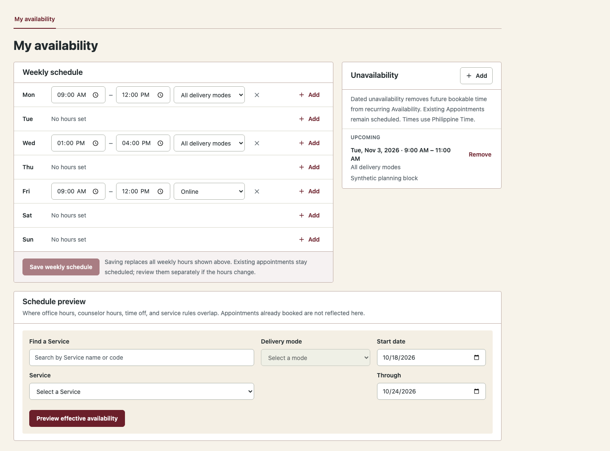
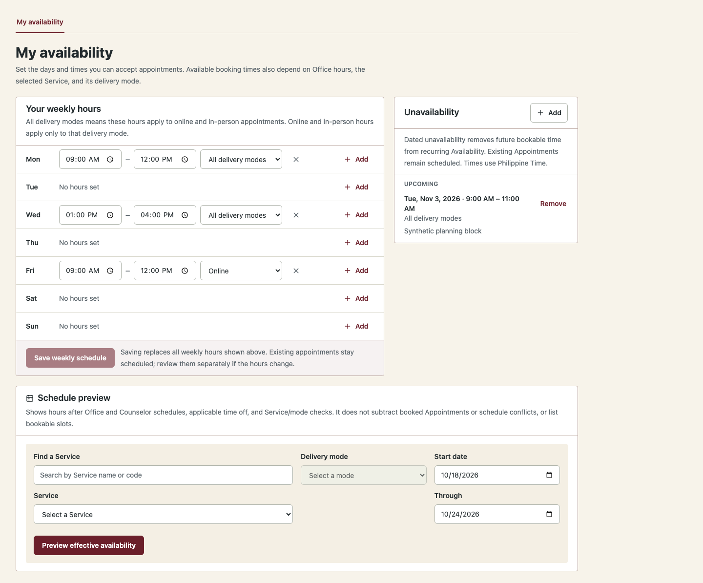
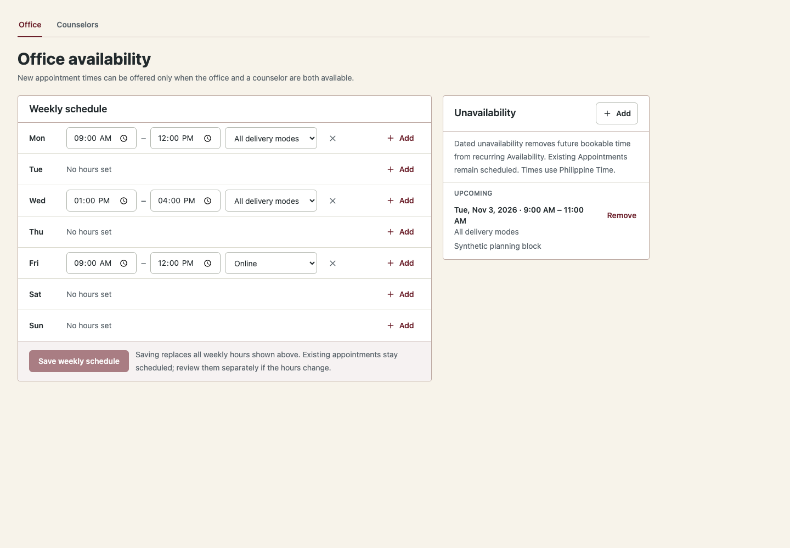
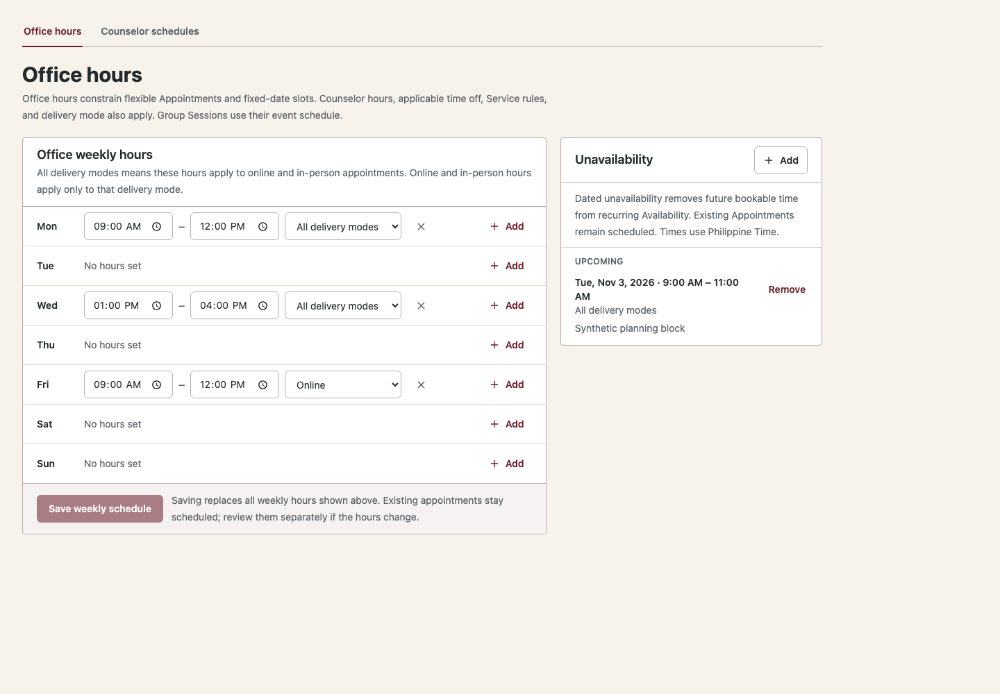
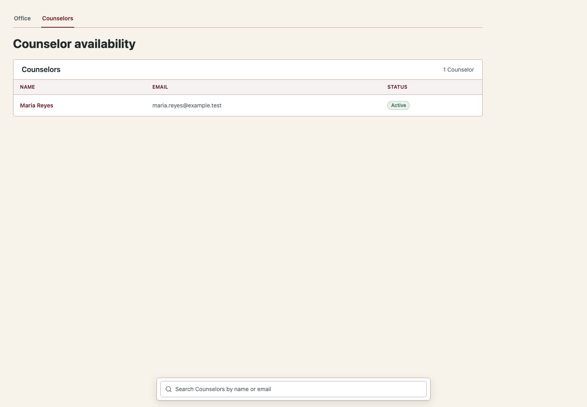
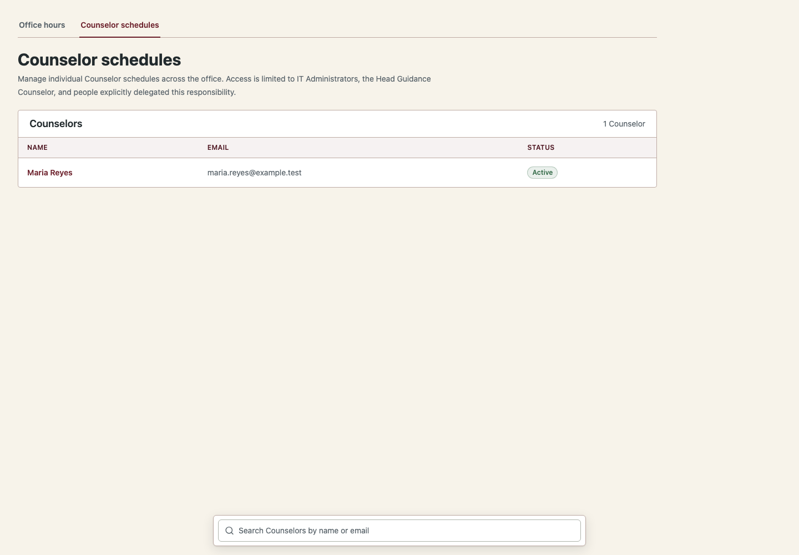

# COMPASS-OPS-1A — Availability Experience and Scheduling Governance

**Branch:** `codex/ops-1a-availability-governance`

**Target:** `staging`

**PR:** [#278](https://github.com/ils12058/COMPASS/pull/278)

**Implementation commit:** `ce6f648ab7de9c1b5ba7bd5a36c746dcfbbcbd4d`

**Merge or deployment:** None

## Summary

The audit found no default authorization defect: ordinary Counselors can manage their own schedules, while office and cross-Counselor changes require the broad `availability.manage` capability. IT Administrators and the Head Guidance Counselor designation receive that capability by default; explicitly delegated users may receive it through the existing per-account capability override system. The backend enforces these boundaries.

This change clarifies Office hours, personal Counselor hours, the managed Counselor schedule workspace, and the limits of the effective-hours preview. It also corrects stale documentation about recent MFA and improves the mobile layout of the weekly schedule's save safeguard. No database schema, migrations, booking calculations, or role assignments changed.

## Scheduling behavior verified

For flexible individual Appointments, base Availability is:

```text
Provider weekly hours ∩ Office weekly hours
− applicable Office unavailability
− applicable Provider unavailability
```

Weekly schedules are expanded in the configured institutional timezone. `ALL` windows apply to online and in-person delivery; `ONLINE` and `IN_PERSON` windows apply only to the matching mode. Applicable dated exceptions are subtracted, and the result is clipped to the requested range. The Service must be active and support the selected mode, and the Counselor must be active, qualified, and eligible to deliver it. For the flexible-appointment path, windows shorter than the Service's configured default duration are removed. The preview shows these hours; it does not subtract booked Appointments or schedule conflicts and does not return bookable slots.

| Booking path | Scheduling rules |
| --- | --- |
| Flexible individual Appointment | Uses the base Office/Provider intersection and applicable exceptions. Slot generation then applies Service duration and filters schedule commitments and reservations. |
| Fixed-date individual slot | Uses an explicitly scheduled slot. Creation, update, publishing, and Student booking recheck base availability, Counselor qualification, delivery mode, and schedule conflicts. A booked slot creates the canonical Appointment. |
| Group Session | Uses its own event schedule, capacity, registration, and facilitator rules. It does not use base Office Availability; Office hours do not automatically govern the event. Its overlap checks use scheduled Appointments, published fixed slots, and other Group Sessions. |

Availability edits do not silently move or cancel existing Appointments. Future flexible availability is recomputed; fixed-slot actions recheck eligibility at their applicable lifecycle stages. Group Session schedules remain governed by their event workflow.

## Authorization audit

| Account or designation | Default Availability capabilities | Effective scope |
| --- | --- | --- |
| Student | `availability.view` | Reads effective Availability; cannot read raw schedules or mutate them. |
| Counselor | `availability.view`, `availability.manage_self` | Reads effective Availability and manages only their own Provider weekly schedule and exceptions through `/availability/me/...`. |
| Head Guidance Counselor (Counselor designation) | Counselor defaults plus `availability.manage` | Also manages Office schedules and any eligible Counselor's raw schedule. |
| Guidance Services Staff | `availability.view` | Reads effective Availability. No self-management or administrative grant is assigned by default. |
| IT Administrator | `availability.view`, `availability.manage` | Manages Office schedules and any eligible Counselor's raw schedule. |
| Other roles, including Institutional Officer and DPO | No default Availability grant | Can receive only the capabilities explicitly granted to their account. |
| Explicit `availability.manage` grant | Per-account override, independent of default role | Broad Office and cross-Counselor management. The current model has no provider-limited delegation capability. |

Self-service routes derive the Counselor from the authenticated request and require an active Counselor plus `availability.manage_self` or `availability.manage`. Office and provider-management routes require `availability.manage`; effective-Availability reads require `availability.view`. Frontend checks only control presentation. The backend is authoritative.

Capability overrides are resolved from current account state on each request. An explicit `REVOKE` suppresses a default or designation grant. The regression test exercises a delegated weekly-hours and exception write, then revokes the grant and verifies the same session receives `403` on a subsequent cross-provider write.

### Finding and deferred policy decision

No default vulnerability allowing ordinary Counselors to manage one another's schedules was confirmed. Existing administrative access is intentional and explicit delegation is supported. However, `availability.manage` is broad: a delegated user with that capability can manage Office hours and any eligible Counselor schedule. If the institution wants delegation limited to named providers or to Office-only work, it must approve a narrower capability/scope policy. This PR preserves the established capability model and does not invent that policy or remove legitimate administration.

Availability mutations do not require recent MFA. The backend tests verify that Head Guidance Counselor administrative writes and delegated writes work without step-up. The README and ADR-019 now match this implemented boundary; account capability changes remain subject to Account Management's own authorization and step-up rules.

## Implemented changes

- Renamed navigation and headings to **Office hours**, **Your weekly hours**, and **Counselor schedules**. Added concise descriptions distinguishing individual hours from Office constraints and identifying the broad responsibility of authorized schedule managers.
- Identified whose schedule is open on the Counselor detail page.
- Explained `ALL`, online, and in-person scope in the weekly editor.
- Made the preview's limits and empty-result uncertainty explicit; it does not claim a specific cause the API cannot identify.
- Clarified the Service/mode/Counselor eligibility error.
- Stacked the weekly save action and its existing-Appointment safeguard on narrow screens so the note remains readable.
- Corrected stale recent-MFA statements in `be/README.md` and ADR-019.
- Added or updated focused backend, frontend-rendering, and responsive browser regressions. Existing schedule clear/edit confirmations, unsaved-change protection, and audit behavior remain in place.

## Screenshots

The captures use the real Availability page components with synthetic fixture data and the local compiled stylesheet. No live student or counselor records are included. Full result manifests are in the `before/` and `after/` directories.

### My availability

| Before | After |
| --- | --- |
|  |  |

After at 320 px: `docs/ops-1a/screenshots/after/after-my-availability-narrow-phone.png`.

### Office hours and Counselor management

| Before: Office | After: Office | Before: directory | After: directory |
| --- | --- | --- | --- |
|  |  |  |  |

The remaining provider-detail captures are `before-counselor-detail-desktop.png` and `after-counselor-detail-desktop.png` in those same directories.

## Validation

- Backend `tests/test_availability.py` and `tests/test_availability_reservation_neutrality.py`: **33 passed**.
- Frontend `tests/availability-schedule.test.mjs`: **17 passed** after the phone-width refinement.
- Browser captures: **4/4 before** and **5/5 after**, including a 320 px viewport. The phone check verifies the save safeguard note is full-width and below the save button.
- Ruff on `be/tests/test_availability.py`: **passed**.
- Full frontend ESLint (`./node_modules/.bin/eslint .`): **passed**.
- Frontend TypeScript (`./node_modules/.bin/tsc --noEmit`): **passed**.
- Production frontend build (`./node_modules/.bin/next build --webpack`): **passed**, including Next's build-time TypeScript and 92 static-page generation steps.
- `git diff --check`: passed after the final frontend changes.

`pnpm lint` stopped before running lint because pnpm's no-TTY guard attempted to replace this worktree's shared `node_modules`. No dependency replacement was performed; the direct ESLint binary completed successfully. The default Turbopack build also could not resolve the `next` package symlink outside the worktree's filesystem root. The Webpack production build completed successfully without changing project configuration.

## PR handoff

PR #278 targets `staging` and remains unmerged and undeployed.
