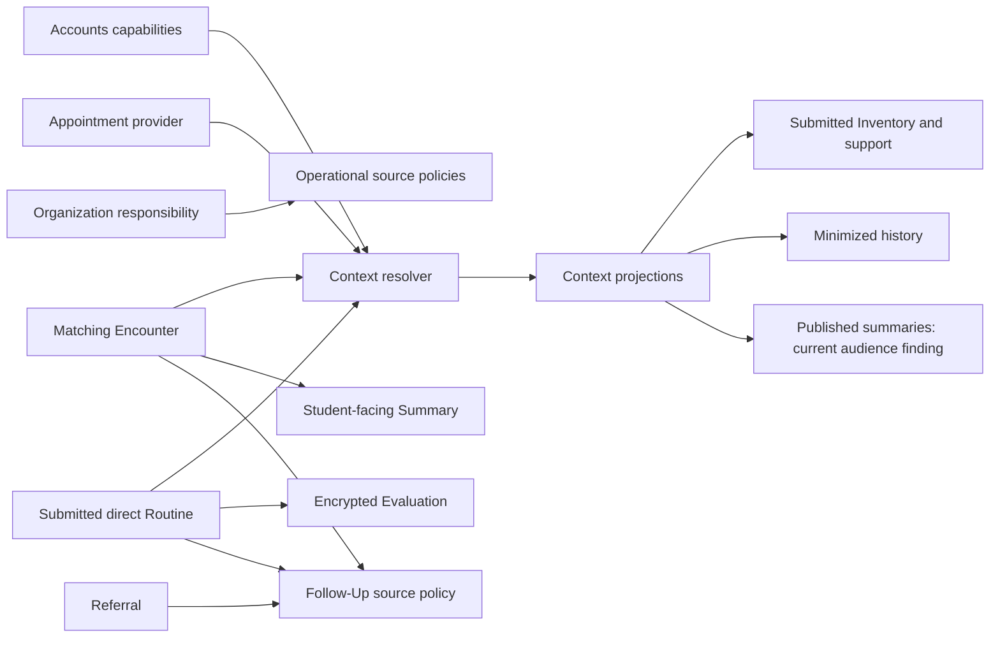

# Current architecture and ownership

All statements in this file describe baseline source unless explicitly labeled proposed. Links are repository-relative; symbols identify evidence precisely. Existing tests cited here were inspected; only the subset in [validation](validation.md) was executed.

## Relationships that must remain distinct

| Relationship | Authority and lifetime | What it does not authorize |
| --- | --- | --- |
| Appointment provider | `Appointment.provider`, per scheduled interaction | Another Counselor's completed records |
| College responsibility | `CounselorResponsibility`, current active College/Campus; unique-Head fallback | Counseling Appointment/provider ownership or confidential Evaluation readership |
| GSS supervision | `StaffSupervision`, current active Counselor supervisor | Inheriting Head designation or professional-content rights |
| Routine assignment | `RoutineInterview.counselor`, original interaction | Other historical Routine Interviews |
| Encounter authorship | `CounselingEncounter.counselor`, historical completed interaction | Student-wide longitudinal case ownership |
| Counseling Context | Resolver-derived actor/anchor/Student/time tuple, recalculated on read | Permanent assignment, old Evaluation bodies or mutation authority |
| Follow-Up assignment | `GuidanceFollowUp.assigned_to` plus visibility/source policy | The source's readership or manage capability |
| Institutional approval | No continuity approval implemented | Decryption merely because an actor approves |
| Case continuity | **Proposed only** | Appointment/College/Student-affiliation changes |

## Domain inventory

| Owner / actual models | Services / routes and capability boundary | Consumers and disclosure limits |
| --- | --- | --- |
| `counseling`: `CounselingEncounter`, `CounselingSharedSummary` | [models](../../be/compass/counseling/models.py), [services](../../be/compass/counseling/services.py): `list_my_encounters`, `get_encounter_for_actor`; [API](../../be/compass/counseling/api.py) requires active Counselor + `counseling.view_assigned`/`manage_assigned`. Summary reads/writes have separate `shared_summaries.*` capabilities. | Routine, Feedback, Follow-Ups, E-Counseling consume structural Encounter links. Encounter has Student, Counselor, canonical Service, snapshot, optional unique Appointment, entry/delivery modes and actual times; no private narrative note field. Summary is optional one-to-one PROTECT, ciphertext body, publication and timestamps. |
| `routine_interviews`: `RoutineInterview` | [services](../../be/compass/routine_interviews/services.py): `get_mine`, `get_assigned`, `replace_assigned_evaluation`, `finalize_assigned_evaluation`; [API](../../be/compass/routine_interviews/api.py): `routine_interviews.view_self/manage_self/view_assigned/manage_assigned`. | Optional Inventory and Academic Year preserve initiation provenance; optional unique Appointment/Encounter. Student detail decrypts own Intake only. Assigned detail decrypts Evaluation and submitted Intake; draft Student answers stay hidden. Metadata/queues do not decrypt. Cancelled/no-show parent blocks mutations, not historical assigned reads. |
| `appointments`: `Appointment`, reminders/history models | [access](../../be/compass/appointments/access.py), [services](../../be/compass/appointments/services.py), [API](../../be/compass/appointments/api.py): `appointments.view_self`, `manage_self`, `manage`. | Counseling is relationship-only. Non-Counseling management has handled-College rules; current Head management is provider-only even there. Service eligibility, availability, overlap and linked-record reassignment guards remain separate. |
| `guidance_followups`: `GuidanceFollowUp`, `GuidanceFollowUpEvent`, `GuidanceFollowUpMutation` | [policy](../../be/compass/guidance_followups/policy.py): `current_actor`, `require_source`, `require_assignee`, `scope`; [services](../../be/compass/guidance_followups/services.py); `guidance_followups.view/manage`. | Operational and Counselor-confidential visibility differ. All reads require exact assignee plus current Student/source eligibility. Confidential assignment requires source **manage** authority. Events/outcomes/descriptions use domain encryption; durable replay and positive version protect mutations. |
| `referrals`: `Referral`, `ReferralAction` | [services](../../be/compass/referrals/services.py): `get_referral`, `_scope_queryset`; `referrals.view/manage` + active Counselor/GSS. | Current Student affiliation in handled Colleges, or explicit Head domain oversight. Source reason/content and action remarks encrypted. Context exposes receipt/status/reference metadata only. Call Slips and Follow-Ups consume validated links. |
| `call_slips`: `CallSlip` | [services](../../be/compass/call_slips/services.py): `get_call_slip`, `get_my_call_slip`; `call_slips.view/manage/view_self`. | Scoped operational Counselor/GSS access; Head domain oversight. GSS issuance uses current supervisor as issuer. Student gets own safe projection; office remarks/source detail are not implied Student access. Context history omits narrative and destination details. |
| `assessment_records`: `AssessmentType`, `StudentAssessmentRecord` | [services](../../be/compass/assessment_records/services.py): `require_actor`, `_records`, `get_record`; `assessment_records.view/manage`. | Effective capabilities, active canonical Counselor. Head has default capabilities and domain-wide record scope; ordinary Counselor needs approved override and handled-College scope. Catalog authority is capability based. Result/score/interpretation/remarks encrypted with record+Student+type binding. No initial continuity access. |
| `inventory`: `StudentInventory` and normalized family, education, sibling, organization, geography, transport, reopen models | [services](../../be/compass/inventory/services.py): `get_inventory_for_counselor`, `list_student_inventory_history`, self/current workflows; `inventory.view_self/manage_self/view/reopen`. | Submitted detail requires current Counselor scope (Head domain oversight). Own history belongs to Student. Context intentionally has a separate relationship-derived submitted-detail path. Draft/reopened answers unavailable to Counselor detail. Sensitive scalar/child content uses domain encryption. |
| `student_support`: `StudentSupportProfile` | [services](../../be/compass/student_support/services.py): `build_student_support_context`, `get_student_support_context`; API adds `student_support.view`. | Current submitted Inventory factual PWD/solo-parent/4Ps/IP/parent-death indicators only; no snapshot, diagnosis, Evaluation or assessment result. Context calls builder after Context authorization. |
| `ecounseling`: `ECounselingRoom`, `ECounselingConsent`, `ECounselingMediaCapture`, `ECounselingMediaArtifact` and webhook/custody records | [services](../../be/compass/ecounseling/services.py): `_require_student_relationship`, `_require_counselor_relationship`; [media](../../be/compass/ecounseling/media.py), [artifacts](../../be/compass/ecounseling/artifacts.py). `ecounseling.view_self/view_assigned`, separate join/consent/manage/access-media capabilities. | Student and exact provider workspaces differ. Media access additionally checks storage binding, stored/disposed states and audit, returning expiring private URLs. Consent and join windows are independent of Context. Recording/transcript and credentials excluded from continuity. |
| `accounts`, `organization` | [policy](../../be/compass/accounts/policy.py), [capability services](../../be/compass/accounts/services.py), [scope](../../be/compass/organization/access_scope.py) | Role grants + designation grants + nonexpired overrides, explicit REVOKE and dependency pruning. Active flags and role qualification remain important. No Acting Head designation or continuity capability exists. General Guidance visibility differs from handled responsibility. |
| `notifications`, `audit`, `confidential_data` | [notification policy](../../be/compass/notifications/policy.py), [current delivery](../../be/compass/notifications/current.py), [audit service](../../be/compass/audit/services.py), [crypto](../../be/compass/confidential_data/crypto.py) | Durable notification intent/recipient + channel-specific delivery, content-minimal external messages; target links are navigation, not authority. Audit is append-only by application convention; no cryptographic tamper-proof guarantee. Crypto provides bound JSON, not actor authorization. |

The listed capability checks are the **combined API/service boundary**, not a claim every low-level function checks all capabilities. For example, `get_encounter_for_actor` checks identity/active role while the route checks the capability; `get_assigned` checks original assignment. Never expose such helpers as a new grant path without a complete service-level gate.

## Dependency structure

## Read paths, dashboards and discovery

`counseling.services.list_students` searches active Student identity for recording a new encounter; it is not permission to read that Student's old records. Routine direct candidates likewise support initiation, with optional small Inventory provenance, not professional-history disclosure. College scope is not a prerequisite to every direct interaction.

[Overview](../../be/compass/overview/services.py) and [Guidance Operations](../../be/compass/guidance_operations/services.py) compose domain-owned counts, not raw Evaluation/summary bodies. Routine pending work is exact-assignment scoped. Source links in Follow-Ups use `visible_source` and reauthorize on destination reads. No inspected report path grants access to Summary content; continuity must not be added to broad report/export populations.

The frontend's [Counseling workspace](../../fe/src/features/counseling/counseling-workspace.tsx) uses generated Context hooks and exposes Overview, Routine, Inventory, Support, History and Shared Summaries sections as applicable. Encounter detail includes author summary tools. [Student summary pages](../../fe/src/features/counseling/student-shared-summaries.tsx) consume published self APIs. [Routine workspace](../../fe/src/features/routine-interviews/routine-counselor-workspace.tsx) and Evaluation forms retain assigned ownership and finalization. UI gates supplement backend enforcement.

Authority sources inspected: ADR-006/017/021/023/025/048/055/056/066/079/080/087/088/099/108/116 and current source refinements. ADR-025's plaintext description and ADR-080's old migration choreography are historical; the current model is ciphertext-only and the immutable canonical baseline supersedes the old graph. ADR-099's original non-Counseling Head Appointment-wide rule is also superseded by the current provider-only Appointment policy. This audit follows code where older prose differs.
