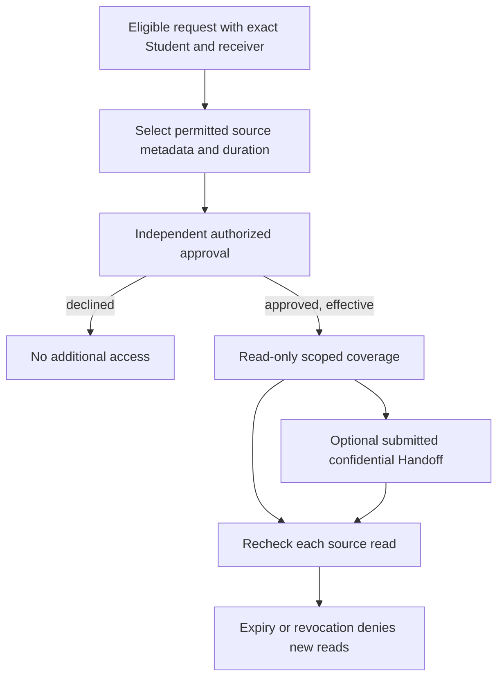

# Proposed handoff, absence and user experience

No workflow described here exists yet. [Authorization](continuity-authorization-design.md) and [institutional decisions](institutional-decisions.md) are prerequisites. A Handoff Summary is optional for coverage activation; original Counselor availability is not a technical prerequisite.

## Planned handoff

1. An institutionally eligible requester opens a contextual “Request coverage” action from their existing Counseling/Routine workflow. Identify one Student, one active receiving Counselor, coverage kind/reason code, exact finite dates and exact selected source records. Show minimal selection metadata, not unrelated content.
2. The original Counselor may select their own relevant finalized sources and optionally prepare a separate Handoff draft. They cannot authorize another audience by publishing a Student Summary. The request stores a reviewable scope snapshot/version.
3. An authorized Head/delegated approver reviews requester, Student reference, receiver, purpose category, duration, source types/UUID/date/author metadata, conflict/overlap warnings and policy evidence. Raw Evaluation/Intake/Handoff content is not required or fetched. Changes to material scope require requester review/new version.
4. Deliberate approve/decline confirmation shows who receives what until when. Backend rechecks current authority/receiver/sources, locks/version-checks and audits. Approval before `starts_at` shows “Scheduled”; the backend clock activates it. Notifications carry only a generic update and authenticated destination.
5. Receiver opens “My case coverage”, sees approved Student/author/purpose, start/expiry and exact scope, and reads one selected source at a time. Every read reauthorizes. They cannot edit original records or use the grant as Appointment/provider authority.
6. If desired, an authorized original Counselor submits the optional confidential Handoff. Receiver acknowledges only if approved procedure requires it; acknowledgment is evidence of receipt, not access approval or proof of understanding.
7. New encounters/evaluations are created through ordinary domain workflows under the receiver's own identity. Appointment and Follow-Up changes, if possible, are separately reviewed mutations.
8. Expiry/revocation stops new grant reads. Close/clear protected displays and recheck server state; retain structural request/decision/access evidence according to approved retention. Authored historical records keep original identities.

## Unplanned absence

An authorized office leader identifies Student/receiver and relevant sources through the approved **metadata-only selection procedure** in [source policy](source-record-policy.md). They request expedited temporary coverage and obtain the required independent approval. No confidential author impersonation or prewritten Handoff is needed. They must not require the absent original Counselor to sign in, copy an Evaluation, submit a summary or change original ownership.

If the only Head is unavailable, a formally approved backup may act only with current effective capability and validated delegation/scope/evidence. If no valid approver exists, record that institutional blocker; arrange legitimate operational care outside a fabricated software bypass. The default recommendation forbids requester/receiver self-approval; policy must provide a viable second authorized person. Urgency does not create unrestricted break-glass authority.

## Distinct Handoff model and audience

Proposed `CounselorHandoffSummary`: UUID, grant PROTECT, Student PROTECT, author Counselor PROTECT, recipient Counselor PROTECT, independent ciphertext, draft/submitted state, submitted timestamp, optional acknowledgment actor/time, created/updated timestamps. Receiver/Student must equal grant references; historical author never changes. Unique one per grant is the minimal initial choice; multiple authors/versioned amendments need separate policy.

Default proposed author: active original Counselor with explicit grant participant/author authority. Unplanned coverage proceeds with no Handoff. If another qualified author is required, institutional policy must define their legitimate source access and attribution first. Request/approval capability alone cannot write professional Handoff text. The receiver may read only submitted Handoff during valid effective coverage; drafts are author-only while authorized. Submission locks ordinary edits. Correction requires an explicit later append/amendment policy, not silent replacement. Former author retention/read rights after grant expiry are **undecided**; recommended initial access denies new Handoff content reads after expiry for both parties except an approved records-governance process. This differs from existing original Evaluation authorship and must be agreed before CONT-3.

Use the proposed independent Handoff keyring/binding in [encryption](encryption-and-cutover.md), verifying grant, Student, author, receiver and Handoff IDs before returning content. Wrong-key/swapped-Student/grant/recipient tokens fail. Do not share Student Summary encryption identity, table, publication event, notification target, template or UI. Student Session Summary, professional Handoff, and structured Routine Evaluation never switch audiences through a visibility flag.

## Operational integration invariants

| Existing workflow | Future continuity effect |
| --- | --- |
| Existing Appointment | None automatically. `reassign_appointment` still requires authorized manager, scheduled-before-start, reason, qualified/available provider and conflict checks. Routine, Encounter or E-Counseling room link blocks reassignment. Head cannot manage another provider's Counseling Appointment solely as approver. |
| Future Appointment | Schedule intentionally with eligible service provider/availability/Student rules; grant does not establish provider coverage or bypass overlap. A new valid Appointment may independently activate ordinary Context. |
| Completed Encounter/Routine | Original Counselor and finalization remain. Receiving Counselor uses read adapters, then records new work under their own ordinary authority. |
| Follow-Up | A grant read does not satisfy current confidential source-manage eligibility. Do not weaken `require_assignee` or downgrade confidential visibility. Operational reassignment/recovery stays a separate validated, versioned, audited operation. If the receiver cannot legally be assigned the old confidential work item, create an appropriate new authorized task or defer a separately approved policy change. |
| Responsibility / affiliation | No `CounselorResponsibility` or `StudentAffiliation` writes. A College transfer prompts scope revalidation under approved policy. |
| Context | Unchanged defaults/resolver. Existing qualifying Context and grant can coexist; the UI names the authority used. Neither widens the other's source selections. |
| Assessment / media / messages | No grant-backed disclosure; retained independent domains cannot be traversed through source links. |
| Student publication | Optional own-author Student communication remains an explicit separate action; never expose Handoff content in it. |

## Counselor and approval information architecture

Keep the existing `/portal/counseling` workspace. Add a focused “Case coverage” destination/subsection, not a general Case Management subsystem. Proposed routes such as `/portal/counseling/coverage` and `/coverage/[grantId]` need canonical backend contracts first. Group “My case coverage” (approved/scheduled, expiring, expired/revoked) and “Coverage requests” (requested/declined/cancelled). “Counselor handoff” is a grant detail section, not a second evaluation workspace. Avoid exposing approval lists to every Counselor.

Head/validated backup sees “Pending approvals” and “Approved coverage” with review/revoke and structural audit history. Exact Student/receiver, source scope and expiry are always visible before approval. Expiring status is derived from server time under an agreed display horizon, never an automatic renewal. “Expired” means new grant access denied; show original source author and coverage authority separately.

Reuse `fe/AGENTS.md` primitives: PageHeader, Panel/RecordSummary/PanelSection, existing labeled actions, standard dialogs/confirmation, generated Orval hooks/TanStack keys. Collections use existing filtering/pagination. No frontend-invented permissions or API routes. Read-only source review uses explicit field labels, author/date and “Available until …”; links cannot imply unrestricted history access. Keep clinical text out of URL/search params, persisted storage, telemetry and previews.

Provide loading, no coverage, no eligible sources, pending/scheduled/expired/revoked, denied, changed version, unavailable ciphertext and refresh-failure states. On authority loss clear body and actions; do not display stale protected content under an unverified offline grant. Keyboard focus stays in confirmations, return focus to trigger, use real links/buttons, visible labels, status announcements and readable mobile layouts/200% zoom. Test phone and desktop, tab order, screen reader names, empty states and denial recovery. Do not repurpose generic Refresh failure to authorize a confidential view indefinitely.

## Student transparency

Initial Student experience remains existing Appointment information and own published Student Session Summaries. A future coverage notice could name the receiving Counselor, interval, safe reason (“Your guidance support is being covered”), contact path for correction/concerns and accurate Appointment updates **only if approved**. Whether notice, consent or another approved basis is required is unresolved; no notice/consent UI should be implemented before that decision. Student navigation never exposes the professional Handoff or approval screen. This application audience policy does not decide legal records-access rights; such requests use institutional procedures.

## Notifications and audit

Reuse current Notification intent, event definitions, recipient/currentness checks, delivery pipeline, link mapping and content-free realtime runtime. Candidate events: coverage requested/approved/declined/revoked, expiry reminder, Handoff submitted/acknowledged. Receiving Counselor and requester receive relevant updates; original Counselor receives a safe update when appropriate; approver receives pending/review events. Student recipients require decision D08. Do not mass-notify all Counselors or supervisors.

Default external channels for new confidential continuity events: **in-app only**, subject to policy. If email/Push is approved, generic wording such as “A guidance coverage request needs your review. Sign in to COMPASS.” No Student name, institutional ID, reason, diagnosis, source title, narrative, date of sensitive interaction or Handoff excerpt in subject/message/body/push/hint. In-app Notification message text is also generic; identity is displayed only after authorized destination fetch. Approval does not put raw source text in the notification object.

Add source-owned currentness for continuity events before retry/send; revoke/expire/deactivate/recipient change suppresses stale pending delivery. Deep links reload canonical access; stale links deny. Audit requester/approver/receiver, exact scope, version, interval and bounded reason codes through the existing synchronous service. Keep technical logs content-free; access-monitoring authority and retention remain institutional gates.
