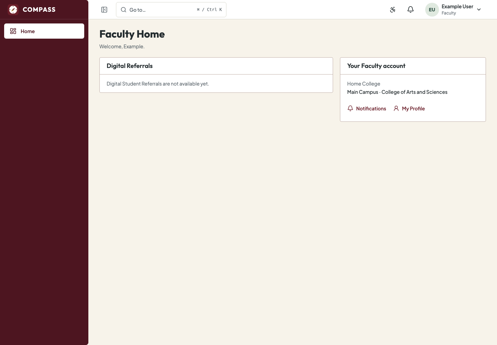
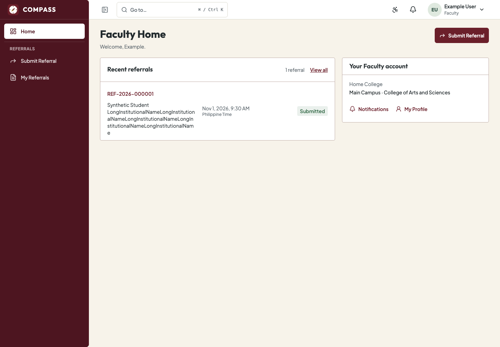

# Faculty Portal visual evidence

All content is synthetic. Approved-state images demonstrate isolated test-policy
behavior, not live institutional activation. Dates/references in the real-backend
images were returned by that disposable canonical backend.

| Capture | Evidence |
| --- | --- |
| [Unavailable Home](screenshots/home-unavailable.png) | Default-safe state, no submission action or fake records/counters; read-only College and existing account destinations |
| [Approved Home](screenshots/home-approved.png) | Primary Submit Referral, actual own projection rows and institutional home; intentionally long synthetic name |
| [Desktop form](screenshots/form-desktop.png) | Exact ID confirmation, source-shaped fields and bounded primary action |
| [Desktop review](screenshots/review-desktop.png) | Student/name and current confidential form review before explicit submit |
| [320px form, 200% text](screenshots/form-320-enlarged.png) | Labels, controls and long content reflow without horizontal overflow |
| [320px detail, 200% text](screenshots/detail-320-enlarged.png) | Minimal own projection and no confidential reason readback |
| [Real canonical success on phone](screenshots/real-submission-phone.png) | Actual server reference/time and Submitted after deliberate 200 replay of a committed result |
| [Real own list](screenshots/real-own-list.png) | Actual synthetic Faculty-owned backend submissions |

