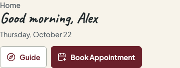
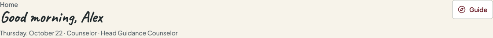

# FINAL-UI-1 Home header visual evidence

All content is synthetic (browser fixtures; no live account or record is touched).
Every role's Home now shares one header: a Caveat script greeting, the "Home"
context, and the office date with the reader's role context when a designation is
held. Role-specific commands stay in the header actions. Captured at 320, 390 and
1440px against the production test build; no horizontal overflow at any width,
including 200% text (asserted by `fe/tests/simplify-3b-caveat.browser.mjs`).

| Role | 320px | 390px | 1440px |
| --- | --- | --- | --- |
| Student | [320](screenshots/STUDENT-320.png) | [390](screenshots/STUDENT-390.png) | [1440](screenshots/STUDENT-1440.png) |
| Counselor | [320](screenshots/COUNSELOR-320.png) | [390](screenshots/COUNSELOR-390.png) | [1440](screenshots/COUNSELOR-1440.png) |
| Head Guidance Counselor | [320](screenshots/HEAD_GUIDANCE_COUNSELOR-320.png) | [390](screenshots/HEAD_GUIDANCE_COUNSELOR-390.png) | [1440](screenshots/HEAD_GUIDANCE_COUNSELOR-1440.png) |
| Guidance Office Assistant | [320](screenshots/GUIDANCE_OFFICE_ASSISTANT-320.png) | [390](screenshots/GUIDANCE_OFFICE_ASSISTANT-390.png) | [1440](screenshots/GUIDANCE_OFFICE_ASSISTANT-1440.png) |
| IT Admin | [320](screenshots/IT_ADMIN-320.png) | [390](screenshots/IT_ADMIN-390.png) | [1440](screenshots/IT_ADMIN-1440.png) |
| Institutional Officer | [320](screenshots/INSTITUTIONAL_OFFICER-320.png) | [390](screenshots/INSTITUTIONAL_OFFICER-390.png) | [1440](screenshots/INSTITUTIONAL_OFFICER-1440.png) |
| Faculty | [320](screenshots/FACULTY-320.png) | [390](screenshots/FACULTY-390.png) | [1440](screenshots/FACULTY-1440.png) |

Roles without a designation render only the office date; the Head Guidance
Counselor additionally shows "Counselor · Head Guidance Counselor". The Student
header keeps its "Book Appointment" action.

