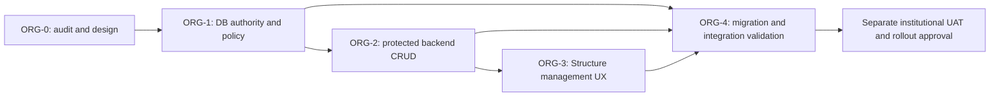

# Implementation handoff — ORG-1 through ORG-4

Everything in this plan is **PROPOSED DESIGN**, not delivered runtime behavior. Source/validation
basis is the exact SHA in [README](README.md). Rebase and re-audit drift before each future slice.
No slice may treat synthetic success as institutional approval, grant authorization or deployment.

SAR remains independent future work; it consumes Organization UUIDs/current-policy interfaces and
must not be implemented to finish ORG. Structural restructuring/imports are separately deferred.

## ORG-1 — Catalog authority and Program metadata

**Prerequisites:** accept replacement/refinement of ADR-064; approve stopped-process cutover and
minimum compatible rollback release; confirm pending/unknown policy compatibility remains unchanged.
Do not require grant decisions to write this foundation: no user catalog mutations ship in ORG-1.

| Work package | Anticipated exact paths | Completion evidence |
|---|---|---|
| Persist one Program policy | `be/compass/organization/models.py`; new small policy module (`program_policy.py`, proposed); `organization/migrations/0002_program_policy_and_catalog_initialization.py` (name provisional); `be/compass/common/canonical_migrations.json` | Validated enum/array/status constraints; raw DB bypass tests; frozen backfill preserves identity/name/status/history |
| Initial seed/adoption | `organization/canonical.py`, `bootstrap.py`; `management/commands/sync_organization_catalog.py`; new initialize command (proposed) | Seed-only alias; receipt and transaction gate; empty vs populated/previously initialized cases; old destructive private sync unreachable |
| Replace all live metadata reads | `organization/api.py`, `inventory/services.py`, `good_moral/services.py`, `good_moral/api.py` | Same ProgramSummary keys/enums/nulls; configured/pending/unknown Inventory semantics; approved new Bachelor passes F4 1–4; F6 unchanged |
| Retire indirect writers/read assumptions | `staging_seed/seed.py`, `verify.py`, `reports.py`, `organization.py`, `students.py`, `staff.py` where needed | Repeated seed preserves edits; fixture selection failure cannot reactivate/rename catalog; reports use current identity or explicitly frozen fixture text |
| Deployment/recovery boundary | `be/deploy/staging/deploy.sh`, `database_preflight.py`, relevant host preflight; `.github/workflows/deploy-staging.yml` only if boundary changes; `be/README.md`, `be/docs/staging-deployment.md`, replacement ADR | Explicit initialize/adopt, no recurring reconciliation; incompatible old image/CLI rollback refused; no live execution implied |
| Tests/fixtures | `be/tests/test_organization_catalog.py`, `test_organization.py`, `test_inventory.py`, `test_program_inventory_academic_context.py`, `test_good_moral.py`, `test_staging_seed.py`, `test_canonical_baseline.py`, `test_openapi_contract.py`; new migration tests (proposed) | Fresh and populated migrations, frozen map, inactive/additional/renamed rows, repeat deployment/direct alias, all policy callers converted |

`0002` is currently free only in Organization. Keep all baseline hashes untouched. Backfill may use
RunPython in the new additive migration; the baseline-only no-RunPython test is not a prohibition on
proper additive backfill. Snapshot baseline map locally in migration, never import mutable live
canonical.py. Freeze initial seed version separately for future installs. [Detailed migration plan](migration-and-rollback.md).

ORG-1 must also introduce a clearly owned active-chain selection helper for current-use consumers
and keep inactive-inclusive reference lookup separate. Do not silently change historical Tracer
eligibility or generic reference APIs; future active versus historical selection must have explicit
consumer tests. No current metadata consumer may fall back to Python after the database is adopted.

**Contract:** preserve existing Organization ProgramSummary and Good Moral degree-options response
shape; no new user CRUD operation or capability enum. Regenerate/check OpenAPI only if actual schema
refactoring changes generated output; no gratuitous generated-client edits. No role/grant activation.

**Release gate:** all checked-in writers retired, fresh/populated synthetic PostgreSQL rehearsal,
compatibility outputs proved, operational old-writer inventory and enforceable deployment boundary
reviewed. Bridge/rollback image must understand the additive schema and DB authority. This gate
precedes any catalog editing. A marker by itself is insufficient.

## ORG-2 — Backend Catalog CRUD and integrity

**Depends on ORG-1.** Resolve eligible staff delegation, pending-policy activation rules,
retirement/remediation contract, pending-F4 warnings and safe history projection.

Anticipated implementation:

- `be/compass/organization/services.py` or focused `catalog_services.py` (proposed) for create,
  rename, status and Program-policy operations; shared normalization/validation; strict immutable
  code/parent after create; typed errors. Existing relationship services remain operational.
- `organization/models.py` + next additive migration (anticipated `0003_catalog_resource_versions`)
  for positive integer resource_version on all three entity models; update migration manifest.
- `organization/api.py` or focused catalog router: existing read endpoints retained; new create,
  rename, status, Program-policy, impact and restricted change-history contracts. No DELETE,
  transfer, alias, code-change or general update-that-accepts-any-field endpoint.
- `accounts/policy.py`, account capability validation/overrides and domain authorization for
  `organization.catalog.manage` with structure.view prerequisite, selected staff-role fence,
  no automatic baseline grants; recent MFA checked at API/service boundary.
- `audit/actions.py` and target-safe history projection using synchronous Audit; semantic existing
  actions retained and one narrow policy-change action added.
- Integrity gate participation in `organization/services.py`, `inventory/services.py`,
  `good_moral/services.py`, `account_management/services.py` where existing user locks would race
  relationship/policy/status changes. Resolve lock order before any mixed deployment of these paths.
- `contracts/openapi.json`, generated Orval client via `fe/orval.config.ts`; update UI capability
  handling only as contract support, not a user grant.

Proposed operation family (names/routes subject to backend convention review, **not existing APIs**):

| Purpose | Request/response essentials |
|---|---|
| Create Campus/College/Program | normalized stable code, name, parent UUID where relevant, Program policy; inactive draft creation explicit; return persisted reference+version |
| Rename | new official name + expected_resource_version + approved bounded reason/basis where required |
| Set active state | desired state + expected version; mutation recomputes impact/blockers in transaction |
| Set Program policy | complete coherent policy + expected version; no partial contradictory status/levels update |
| Impact GET | target/version/observed_at, bounded aggregate counts, typed blockers/warnings; no student contents |
| Restricted history GET | target-specific bounded catalog-safe change records/pagination; no unrelated Audit data |

Avoid polymorphic raw model serializers. Use strict schemas; extra structural fields are invalid.
Use 403 for auth/MFA, 404 unavailable target, 409 typed duplicate/stale/blocked/parent conflict, 422
malformed values, following the existing error envelope. Final operation IDs/error codes must be
pinned by tests and regenerated client, not guessed by ORG-3. Versions must be required on every
consequential update; do not allow null to mean unconditional overwrite.

**Required tests:** deny ordinary organization.manage-only actors, unsupported-role overrides,
expired/revoked/prerequisite-suppressed grants; missing/stale MFA; CSRF; duplicate normalization races;
all invalid parent/status/policy combinations; blocker aggregation and bypass attempts; same-row
stale writers; child/assignment/account-reactivation/Inventory/F4 races; audit-failure rollback;
no-op audit/version behavior; strict transfer/code-field rejection; safe history disclosure.
Use PostgreSQL transaction tests with separate connections/barriers, not SQLite or timed sleeps.

**Release gate:** backend tests and generated contracts pass; no catalog grant activated; ordinary
relationship capability behavior unchanged; code-aware rollback available. Approval-dependent
operational grant assignment remains separate.

## ORG-3 — Existing Structure workspace management

**Depends on ORG-2 contracts and authoritative backend.** Exact owning paths:

- `fe/src/features/organization/structure/organization-structure-page.tsx` (hierarchy/search/status);
  small adjacent form/impact/history components if justified.
- `features/organization/components/organization-gate.tsx`, `organization-navigation.tsx`,
  `organization-action.tsx`, `organization-shared.tsx`; scope catalog entry separately from
  operational tabs; do not change existing relationship continuation semantics incidentally.
- `features/institution-configuration/institution-access.ts` and existing portal navigation
  configuration for explicitly authorized catalog-only managers.
- Existing PageHeader/PageAction, Panel, ContextHelp, form/error and consequential dialog primitives.
- `fe/tests/` and relevant authenticated browser harness for role/permission/MFA/stale-state,
  keyboard and responsive scenarios; generated client only through Orval.

[UX design](ux-and-workspace-design.md) specifies read-only versus editor gates, parent errors,
pending-policy copy, exact level labels, impact confirmation, resource-version conflicts, refresh
failure and unsaved edits. A refreshed impact/version and deliberate confirmation must protect
Catalog after MFA; do not blindly replay a stale command. Keep Student affiliations and
Responsibilities/Staff supervision intact. No new top-level Catalog app or archived editor reuse.

**Release gate:** authorized-manager and existing-viewer browser flows pass, missing permission is
honest, no Student workspace leakage, narrow mobile/200% text/keyboard/screen-reader review complete.
Frontend tests do not establish institutional naming/policy approval.

## ORG-4 — Cross-domain integration and final validation

**Depends on final ORG-1/2/3 heads.** Consolidate distinct executed node IDs and evidence; do not
count repeated runs as new coverage.

| Validation area | Required scenarios / owning paths |
|---|---|
| Authority and migrations | Fresh/install/populated/backfill/retry/failure/recovery matrix; `test_organization_catalog.py`, new migration tests, `test_canonical_baseline.py`, seeder/deployment tests |
| Inventory | Configured valid/invalid, known pending, unknown, additional approved Programs, inactive ancestry, rename/submission snapshots; `test_inventory.py`, `test_program_inventory_academic_context.py`, API/frontend readiness |
| F4 | Newly persisted Bachelor, non-Bachelor/unknown/pending, Year 5 still rejected, saved request replay/correction/preparation/issue and templates; `test_good_moral.py`, preparation/authenticated integration and final-preservation suites |
| F6 | Prior degree with current postgraduate study; advisory suggestions, free historical facts, lifecycle/receipt verification/print preservation; existing Good Moral tests |
| Routing and scope | College/Campus retirement blockers, valid/missing/inactive/ambiguous Head, GSS dynamic workload, provider-owned Counseling access; Organization and appointment management/scope tests |
| History/reporting | Inventory saved course vs live Program label; issued F4/F6 saved output; Tracer live names/retired historical selection; Exit/Routine context, reports and code labels |
| Confidential domains | Catalog authority grants no assessment/counseling/context/coverage access; no encryption/ownership/policy-provider change; current default-deny gates retained |
| Concurrency | Separate PostgreSQL connections: duplicate code, rename/status/policy stale edits, child create vs parent retire, relationship/account enable vs retirement, submit/F4 create vs policy, stale preview, Audit failure |
| API/browser | Authenticated permitted/denied actors, CSRF, MFA setup/verify, stale version/impact, refresh failure and no blind retries; keyboard/mobile/zoom and manual accessibility |
| Release | Exact inspected/implementation heads, workflow/check state, compatible rollback, old-writer retirement, open decisions and no live counts inferred from fixtures |

Relevant additional paths: `be/tests/test_appointment_management_scope.py`,
`test_institutional_identity.py`, `test_capability_dependencies.py`, `test_step_up_policy.py`,
`test_graduate_tracer*.py`, `test_exit_interviews.py`, `test_routine_inventory_decoupling.py`,
`test_inventory_counseling_regression.py`, report/continuity/assessment tests selected by actual diff.
Run focused suites once, widen only for unresolved risk; full CI when configured/authorized, not
repeatedly by habit. Do not add screenshot-only or implementation-mirroring tests as proof of behavior.

**Completion:** synthetic suite and migration rehearsal pass with distinct counts, approved blocker
and academic-policy decisions are documented, manual accessibility and institutional UAT are reported
separately, and release-readiness evidence states remaining limits. No deployment, real-data mutation,
operational grant, policy activation or automatic merge is included in that completion.

## Future controlled restructuring

Document only until separately authorized: College/Program transfers, mergers, code reuse/aliases,
effective-dated hierarchy and approved institutional imports. Requirements include preserving old
identity, explicit period/history mapping, external-code contract, counselor/scope ownership,
pending work resolution, immutable document protection, approval evidence and rollback/recovery.
Do not put these fields into a general ORG-2 update payload “for future flexibility.”
