# COMPASS task-guide expansion

Review handoff, 11 November 2026. Implemented on `codex/task-guide-expansion` in the attached `task-guides/COMPASS` worktree. Base: latest fetched `origin/staging`, `084af2767b60277d4a8f6ff04291a70fae0783f1`. The user subsequently authorized pushing to `staging` and a frontend production deployment to the existing Vercel project, without waiting for hosted CI. Deployment outcome is reported in the delivery message.

## Implementation

The existing optional portal orientation supplies the shared non-modal dialog, focus, scrolling and dismissal behavior. Eleven task definitions reuse it, with source-owned `data-guide-target` attributes and a shared page `Guide` action. The Faculty list offers an accessible task chooser. Help & guides groups implemented guides and launches safe entry pages through the existing unsaved-navigation guard.

Targets resolve from rendered UI. Hidden or later-stage controls use a short explanation and remain finishable. Collections are highlighted at their heading; the guide never picks or opens a private record. Users can open a record or choose a workflow stage themselves and replay the relevant guide there. Guide controls never fill, select, save, send, book, confirm a student, submit or download.

The panel waits for the current step measurement before focusing Next/Finish, follows the visual viewport, and moves above end-of-page controls when there is insufficient room below. Short panels scroll internally. Existing system and COMPASS reduced-motion preferences are respected. Route/query, session and access changes invalidate the guide; other dialogs, menus, drawers and native modals retain priority.

Versioned browser-local state remains independent per guide. The orientation keeps its existing storage key/version; each task stores only `{version,status}` under its non-sensitive guide ID. No account, record, form or message data is stored. Malformed, older/future and unavailable storage do not block use. Completion is browser-local and is shared by use of that browser, not an account-synchronized preference.

## Checklist and launch pages

- [x] Getting around COMPASS: Home → Portal navigation → Find a feature → Your portal bar → Help & guides (visible shell targets determine the available steps). Launch from Home or Help & guides; catalog opens `/portal`. Existing completion is retained.
- [x] Book an appointment: 4 steps; catalog entry `/portal/appointments/book`; Guide on `/portal/appointments/book`.
- [x] Send a message: 4 steps; catalog entry `/portal/messages`; Guide on `/portal/messages`, `/portal/messages/new`, and user-opened record details under `/portal/messages`.
- [x] Manage my appointments: 3 steps; catalog entry `/portal/appointments/my`; Guide on `/portal/appointments/my`, and user-opened record details under `/portal/appointments`.
- [x] Complete Individual Inventory: 4 steps; catalog entry `/portal/inventory/current`; Guide on `/portal/inventory`, `/portal/inventory/current`.
- [x] Request Good Moral: 4 steps; catalog entry `/portal/good-moral`; Guide on `/portal/good-moral`, `/portal/good-moral/request`, and user-opened record details under `/portal/good-moral`.
- [x] Use My actions: 3 steps; catalog entry `/portal/actions`; Guide on `/portal/actions`.
- [x] Complete Exit Interview: 4 steps; catalog entry `/portal/exit-interviews`; Guide on `/portal/exit-interviews`, and user-opened record details under `/portal/exit-interviews`.
- [x] Complete Graduate Tracer: 4 steps; catalog entry `/portal/graduate-tracer`; Guide on `/portal/graduate-tracer`.
- [x] Submit Feedback: 4 steps; catalog entry `/portal/feedback`; Guide on `/portal/feedback`, `/portal/feedback/customer-feedback`, `/portal/feedback/csm`.
- [x] Submit a Faculty Referral: 4 steps; catalog entry `/portal/faculty/referrals/new`; Guide on `/portal/faculty/referrals`, `/portal/faculty/referrals/new`.
- [x] Track My Referrals: 3 steps; catalog entry `/portal/faculty/referrals`; Guide on `/portal/faculty/referrals`, and user-opened record details under `/portal/faculty/referrals`.

All guides provide Start/Replay, Next, Back, Skip, Exit/Escape and Finish without requiring a task submission.

## Final steps, copy and access

These are the final source definitions at handoff; the frontend source remains the owner. “Target missing” copy is used when a later stage or eligible control has not been rendered.

### Book an appointment

`getAppointmentAccess`: `canViewSelf` and `canBook`; current booking availability stays page-owned.

1. **Choose a service and delivery** — Choose an available service. Delivery choices appear for the selected service. Read any requirements before continuing.

   Target missing: Booking is not available in this view. Read the page's current eligibility or availability message before choosing your next step.

2. **Choose a counselor** — Choose from the counselors offered for your service and delivery. If none are available, review the choices above.

   Target missing: Counselor choices appear after a service and delivery are selected, where this booking pathway offers them. Scheduled slots show their own counselor details.

3. **Choose an available time** — Use the existing date and time controls to choose an available slot. Read any no-slots or prerequisite message; a time is checked again before booking.

   Target missing: Times appear after the required choices. If there are no available slots, use the page's date or service choices to check another option.

4. **Review before booking** — Review the service, counselor, delivery, schedule, and requirements. Book only when ready. If the result is uncertain, follow the page's recovery instructions.

   Target missing: A review and booking action appear after an available time is chosen. You can finish this guide without choosing a time or booking. Find confirmed bookings in My Appointments.

### Send a message

`getGuidanceMessagesAccess`: `hasWorkspace`; recipient, composer and conversation access stay page-owned.

1. **Choose a conversation or recipient** — Open a conversation from the directory, or use New message when available. A new message offers only the recipients available to you.

   Target missing: This view shows the current conversation. Return to Messages to choose another conversation, or use New message when available.

2. **Check the conversation** — Check the conversation name and the context shown here before writing. Use the audience and access information on this page.

   Target missing: Open a conversation or choose a recipient yourself to see its identity and available context. The guide does not choose one for you.

3. **Read and compose** — Read the available history and write in the composer when it is enabled. Read-only or unavailable messages explain when you cannot write.

   Target missing: History appears for an existing conversation. The composer appears only where writing is available; read any unavailable or read-only explanation.

4. **Send and check the result** — Send posts your message. Watch Sending and the visible result. If sending is unconfirmed, keep the message and use its existing retry instructions.

   Target missing: Send is available with the composer. You can finish this guide without writing or sending a message.

### Manage my appointments

`getAppointmentAccess`: `canViewSelf`; details teach only exposed actions.

1. **Find an appointment** — Use the list or calendar and the available search and filters to find an appointment. Open its link to see details.

   Target missing: You are viewing an appointment. My Appointments contains the list, calendar, search, and filters. The guide never opens a record for you.

2. **Read status and details** — Read the displayed status, service, counselor, delivery, and schedule. A status describes the current appointment; it does not promise a future action.

   Target missing: Open an appointment yourself to read its current status and details. If the list is empty, there is no appointment to open in this view.

3. **Use available links and actions** — Use only the links and management actions shown for this appointment. Read their conditions and review any confirmation before acting.

   Target missing: Details show only the links and actions available to you for that appointment. Cancellation and rescheduling may be unavailable. You can finish without changing an appointment.

### Complete Individual Inventory

`getInventoryAccess`: `canViewSelf`; editable draft, completed and read-only states remain distinct.

1. **Check your annual record** — Check the academic year and current status. Start or continue only through the controls offered on this page.

   Target missing: Read your current annual status. A submitted or read-only record can be reviewed; starting or editing depends on the controls offered here.

2. **Move through sections** — Use Inventory section or the section navigation to move through the official form in any order. The questions and required answers stay the same.

   Target missing: Section navigation appears in an editable draft. A read-only record displays saved answers instead; the guide does not start a draft.

3. **Keep your draft** — Use Save progress when ready to save changes. Read draft, validation, or retry messages before leaving the form.

   Target missing: Draft controls are offered only for an editable record. Guide buttons do not save, discard, or change your answers.

4. **Review and submit** — Open Review and submit, check missing or invalid answers, and return to the relevant section to correct them. Submit only when ready.

   Target missing: The editable form's Review and submit section shows validation and the final action. A completed or read-only record cannot be submitted here. You can finish this guide without submitting.

### Request Good Moral

`getGoodMoralAccess`: `hasStudentWorkspace`; request eligibility and certificate requirements remain page-owned.

1. **Start with the available request** — Use Request when available, then choose the certificate type offered for your situation. Read the requirements shown for that type.

   Target missing: Read the request's current state. If starting a request is unavailable, the page explains what you can do next.

2. **Check requirements and inputs** — Review the displayed requirements and enter the requested details. Current student and graduate certificates have different inputs.

   Target missing: The request form shows the requirements and inputs for the chosen certificate. Follow those instructions; this guide adds no fees or requirements.

3. **Review and submit** — Check the form details before Submit request. Wait for a confirmed result. If it is uncertain, follow Retry same request or the other recovery instructions shown.

   Target missing: Submit request appears with an available request form. You can finish this guide without creating a request.

4. **Find status and next steps** — Open a request from My requests to read its current status and the next steps or actions available to you.

   Target missing: Good Moral lists your existing requests. Open one yourself to see its status and available next steps; the guide does not choose a request.

### Use My actions

`hasStudentActions`; empty results have a finishable explanation. The current list has no search/filter controls.

1. **Review your action list** — My actions lists tasks that need your attention. An empty list means there are no items in the current result; read the page's empty or loading message.

   Target missing: Read the current list state. If actions could not be loaded, use the page's Retry when ready.

2. **Read task context** — Each item shows its task, available context, timing, and priority. Read these details before opening it.

   Target missing: There is no task item visible in this result. You can finish the guide and return when an action is available.

3. **Open the related task** — Open the task link to continue on its existing page. That page shows the current status and available actions. Use page controls for more results when offered.

   Target missing: Task links and pagination appear only when there are results to open or more pages. This list has no search or filters. The guide does not open a task for you.

### Complete Exit Interview

`getExitInterviewAccess`: `hasStudentWorkspace`; opportunity, eligibility and current-record editing remain page-owned.

1. **Check the eligible entry** — Read the current opportunity and status. Use Start or the existing record link only when offered. Availability and eligibility are shown on this page.

   Target missing: Read the current record and eligibility messages. Completed or read-only records show saved responses; the guide does not start a new record.

2. **Complete form sections** — Use the section links to move through the Exit Interview form. Complete the required ratings and other answers shown in the official sections.

   Target missing: The editable form shows its section links and questions. A completed or read-only record displays saved answers instead.

3. **Save and review** — Use Save draft before leaving. Review and submit shows any missing ratings or validation feedback; follow its links to review answers.

   Target missing: Save draft and Review and submit are part of an editable form. They are unavailable for a completed or read-only record.

4. **Submit when ready** — After saving and reviewing, use Submit Exit Interview when enabled. Read its confirmation and any result or retry message.

   Target missing: Submission is offered only when the form and current availability allow it. You can finish this guide without starting, saving, or submitting an Exit Interview.

### Complete Graduate Tracer

`getGraduateTracerAccess`: `hasStudentWorkspace`; graduate lifecycle and existing self access remain authoritative.

1. **Check your survey status** — Read the survey status. Start Graduate Tracer Survey creates a draft when available; a submitted response is read-only.

   Target missing: Read the current response or availability message. Starting and editing depend on the controls offered here.

2. **Complete survey sections** — Move through the survey's section links and enter the answers requested by the official survey. Employment questions adapt to your answers.

   Target missing: Section links appear in the editable survey. Completed or read-only responses show saved answers instead; this guide does not create a draft.

3. **Save and review answers** — Save your draft changes, then review answers and any validation feedback. Use the section links to correct the answers that need attention.

   Target missing: Draft and review controls appear only for an editable response. Read-only or submitted responses cannot be edited here.

4. **Submit the survey** — Use Submit Graduate Tracer Survey when the saved response is ready. Read the confirmation and visible result before leaving.

   Target missing: Submission is offered only for an available editable response. You can finish this guide without starting, saving, or submitting the survey.

### Submit Feedback

`getFeedbackAccess`: `hasStudentSubmissionAccess`; opportunity eligibility and already submitted states remain page-owned.

1. **Find an eligible opportunity** — Completed Services shows available feedback opportunities. Give feedback opens an available form; Submitted and Not available describe the current options.

   Target missing: This form belongs to the opportunity you opened. Feedback lists available opportunities; if none are eligible, there is no form to start from that list.

2. **Complete the existing form** — Answer the form's required items and any optional items you choose. Read its service context and use section links where offered.

   Target missing: Open an available Give feedback link yourself to see the questions. An already submitted or unavailable opportunity cannot be submitted again here.

3. **Review your response** — Review and submit checks your answers and opens the existing confirmation. Correct any validation feedback before continuing.

   Target missing: Review and submit appears in an available feedback form. The guide does not open a form or a confirmation for you.

4. **Submit and check the result** — Submit only when ready after reviewing the confirmation. Read the confirmed result or any uncertain-result recovery instructions; avoid starting a duplicate response.

   Target missing: You can finish this guide without submitting feedback. Use only the forms currently available for your opportunity.

### Submit a Faculty Referral

`facultyReferralAccess`: `submit`; confirmation, submission availability and review remain page-owned.

1. **Check submission availability** — Use Submit Referral when offered. Read the current availability message before starting or continuing a draft.

   Target missing: Read the current submission availability. If the form is unavailable, you can still finish this guide without starting a Referral.

2. **Confirm the student** — Enter the exact Student institutional ID and use Confirm Student yourself. Check the returned name and confirmation expiry before continuing.

   Target missing: Student confirmation appears on an available submission form. The guide never searches for or selects a student.

3. **Enter referral information** — Complete Course/Year/Block and Referral reason. Follow the requirements beside those inputs and keep observations relevant to the Referral.

   Target missing: Referral information appears with the available form, or as saved information in review. The guide does not fill fields or change your draft.

4. **Review and submit** — Review Referral checks the form. Check the student and reason on review, then use Submit Referral only when ready. Follow any expiry, availability, or uncertain-result instructions.

   Target missing: The available form leads to Review Referral and then Submit Referral. You can finish this guide without confirming a student or making a submission.

### Track My Referrals

`facultyReferralAccess`: `read`; only the existing Faculty administrative disclosure is described.

1. **Find your submission** — Submitted Referrals shows your available submissions with the reference, student, submitted time, and status. Use page controls for more results when offered.

   Target missing: My Referrals lists the submissions available to you. If none are visible or the workspace is unavailable, read the current page message.

2. **Open referral details** — Open the reference link yourself to see the submission details. Check the student and submission reference before reading updates.

   Target missing: Open a submission yourself when a reference link is available. The guide does not choose a student or Referral.

3. **Read the exposed updates** — Read the displayed administrative status and any received or closed dates. Administratively Closed means administrative handling is complete; it does not establish a counseling outcome.

   Target missing: Referral details show only the administrative information available to Faculty. You can finish without opening a record; the guide adds no internal staff or counseling information.

## Verification

Final validation results are recorded in [validation.md](validation.md). Automated evidence uses the production Next build with safe local synthetic fixtures and blocked external requests. Test-specific writes are rejected in the task-guide fixture; no live staging account, draft or record was used.

## Frontend boundary

Changes are limited to frontend guide infrastructure, copy, source-owned targets, launch actions, discovery and tests, plus this review evidence. `be/**`, `contracts/openapi.json`, backend models/migrations/permissions/workflows, API requests and response shapes are unchanged. There are no guide-specific requests, analytics, new dependencies or server preferences. Generated API code was regenerated through Orval and was not manually edited or added to Git. The automatic `next-env.d.ts` build-path rewrite is excluded from the final diff.

## Screenshots

Every image uses synthetic data. These are representative entry-page steps, not proof that every workflow stage is available to every account.

### Book an appointment

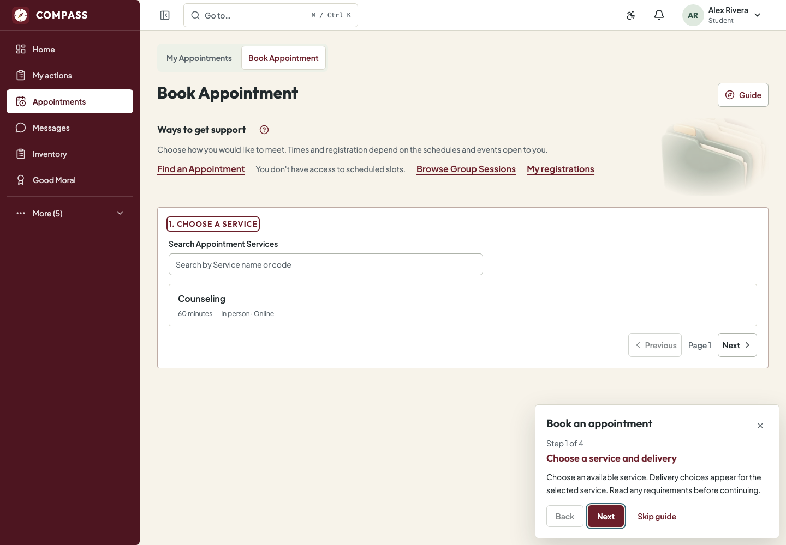

### Send a message

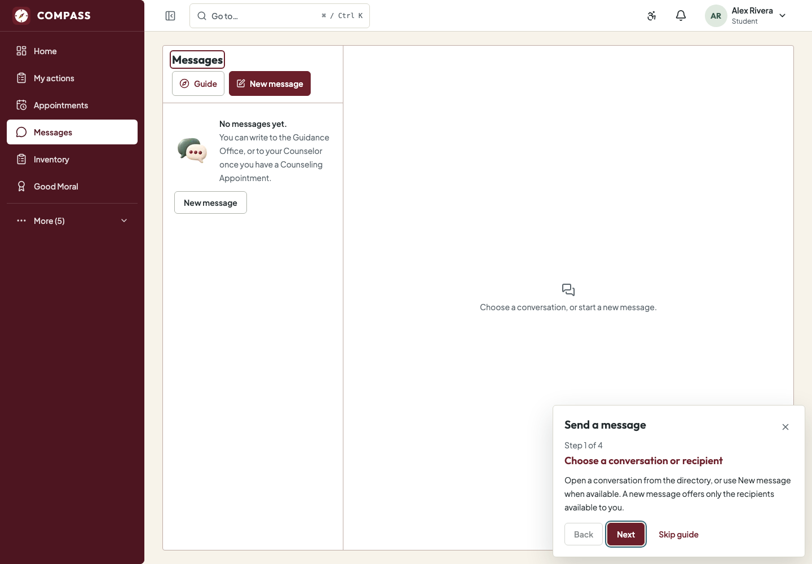

### Manage my appointments

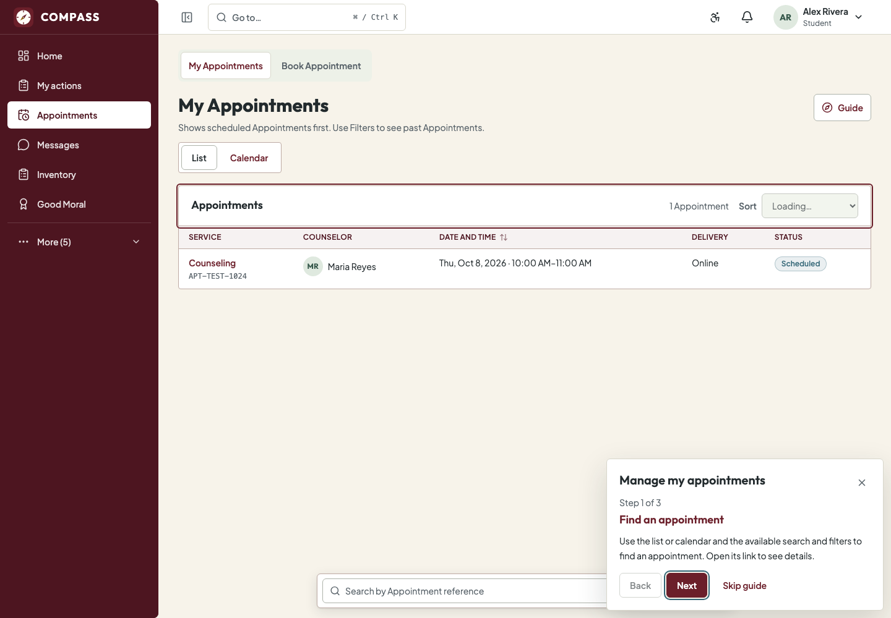

### Complete Individual Inventory

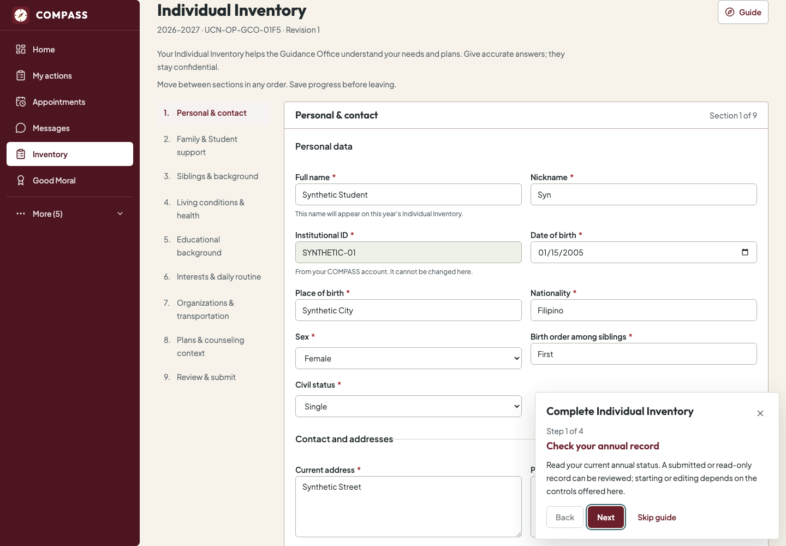

### Request Good Moral

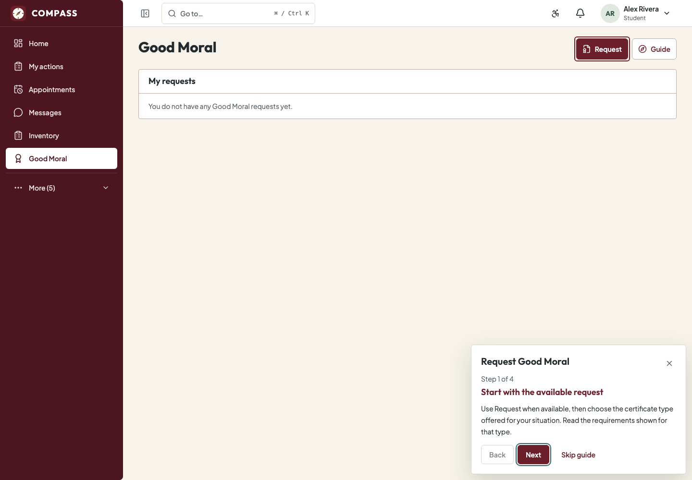

### Use My actions

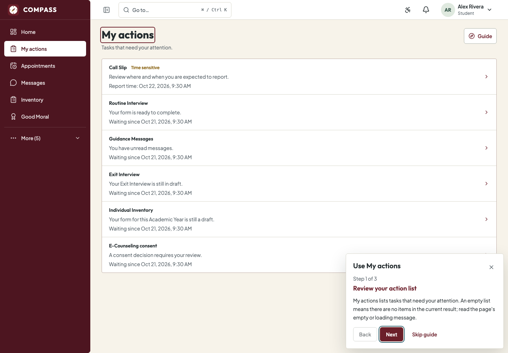

### Complete Exit Interview

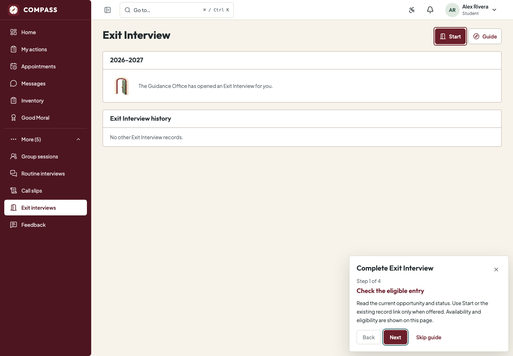

### Complete Graduate Tracer

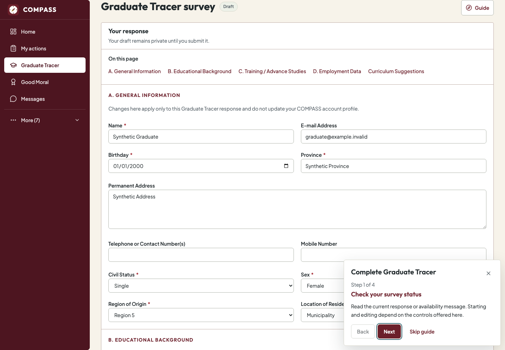

### Submit Feedback

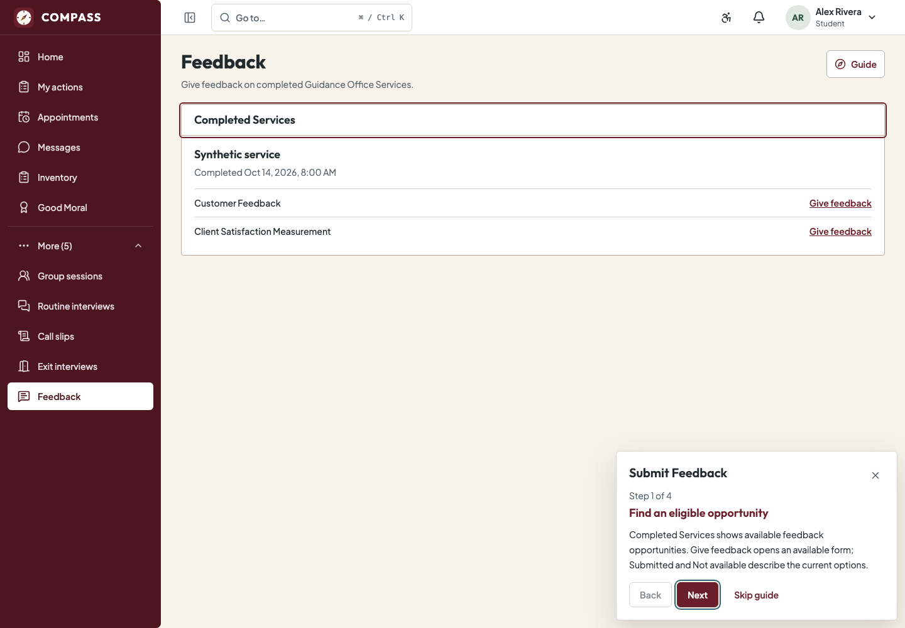

### Submit a Faculty Referral

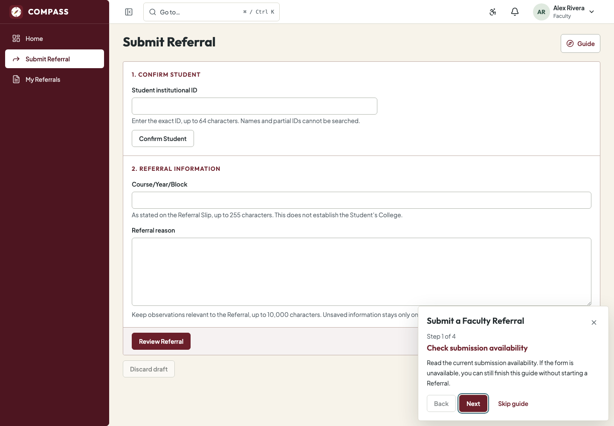

### Track My Referrals

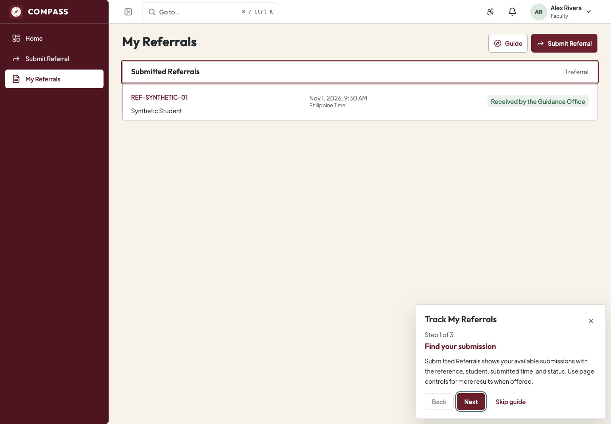

### Help & guides — desktop

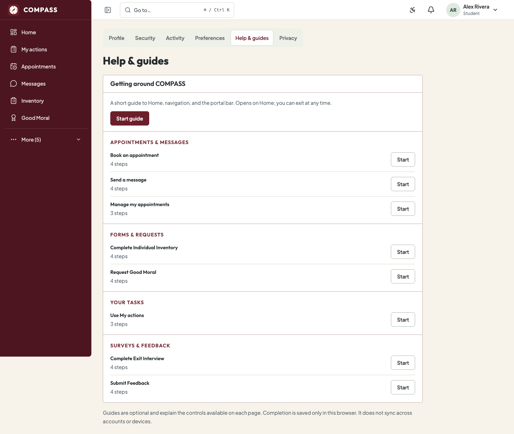

### Help & guides — narrow

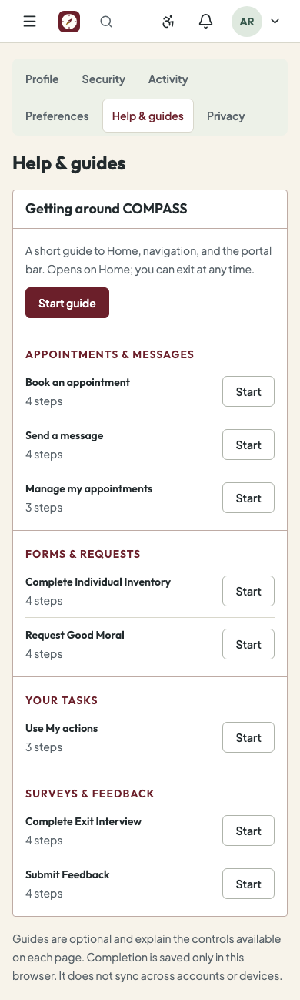
