# Before and after

All captures use the same synthetic Counselor, Student, Evaluation values, and Encounter records. Before captures come from the fetched `c5f1bb2b` integration baseline; after captures come from the final production build. Desktop uses 1440×1000 and phone uses 390×844. Rating, narrative, dirty, and saved views use equivalent interactions.

| View | Before | After |
| --- | --- | --- |
| Desktop beginning |  | 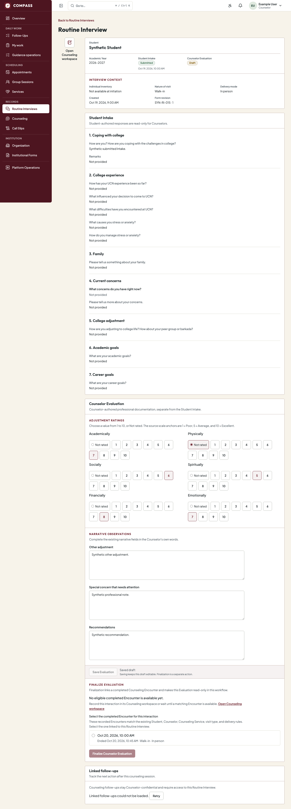 |
| Phone beginning | 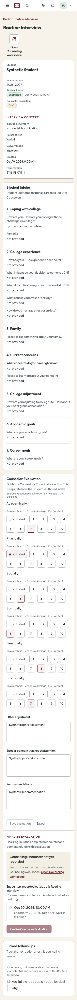 | 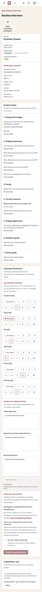 |
| Desktop ratings | 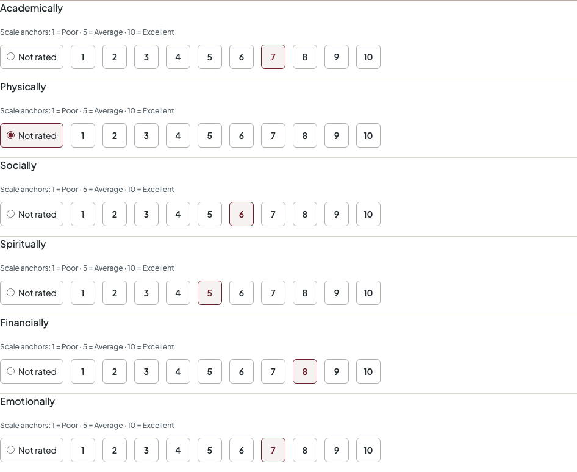 | 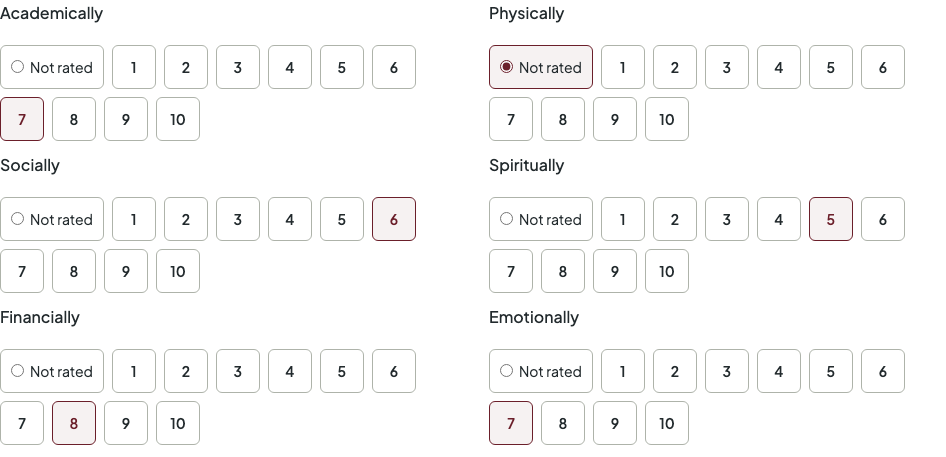 |
| Phone ratings | 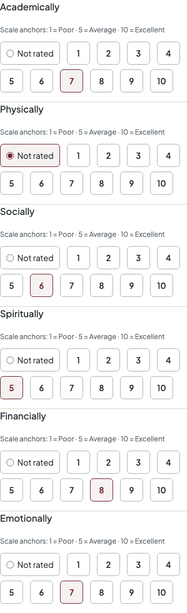 | 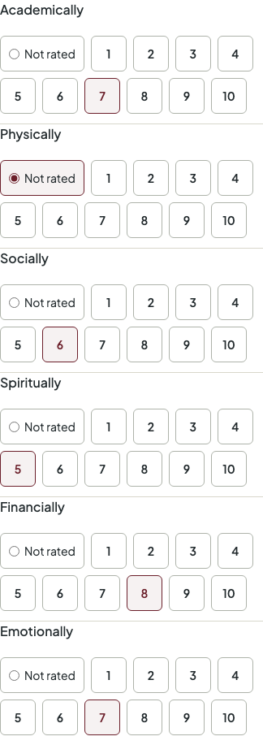 |
| Desktop narrative fields | 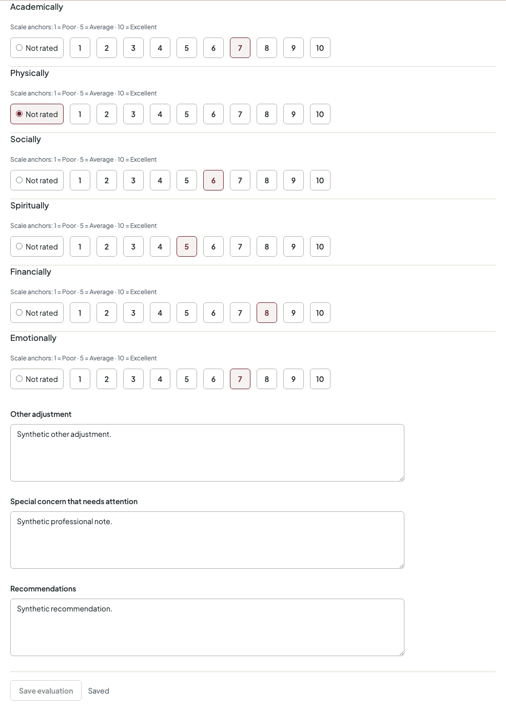 | 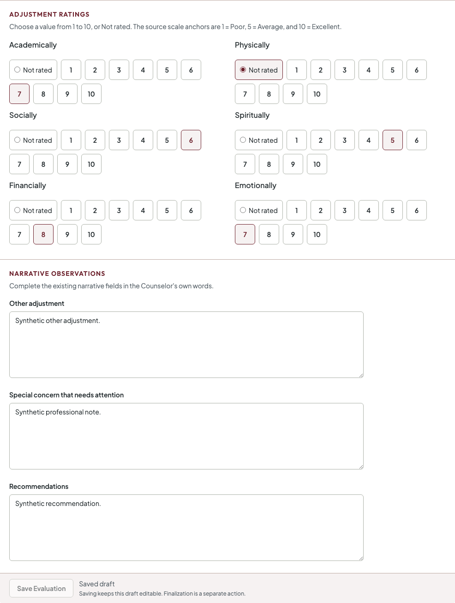 |
| Phone narrative fields | 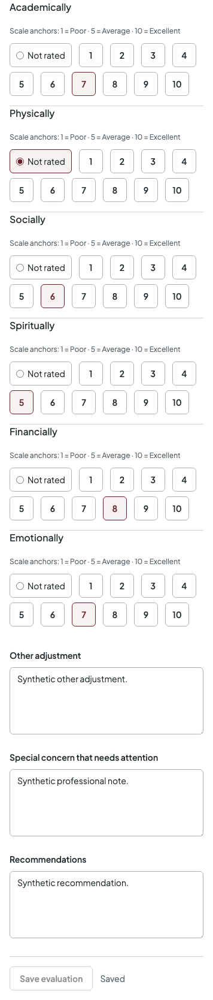 | 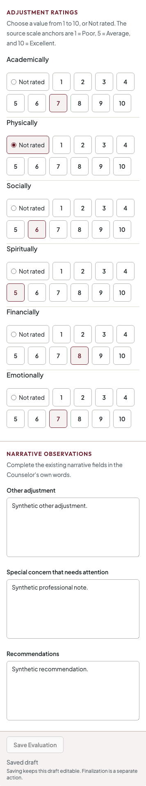 |
| Desktop unsaved draft |  | 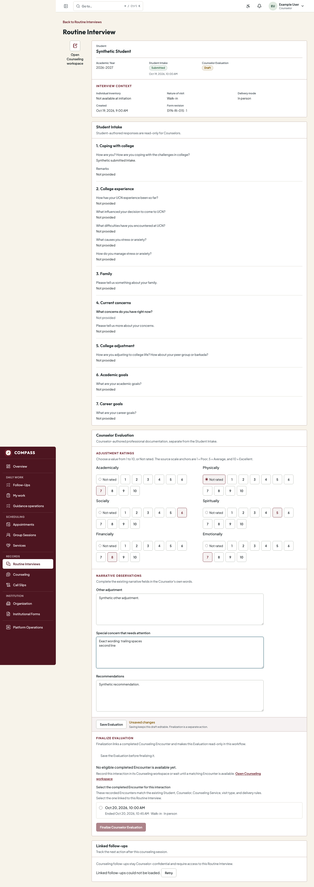 |
| Phone unsaved draft | 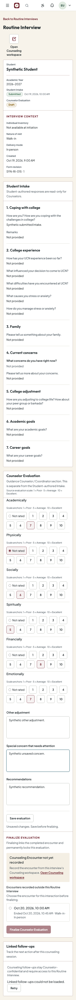 | 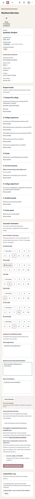 |
| Desktop confirmed save | 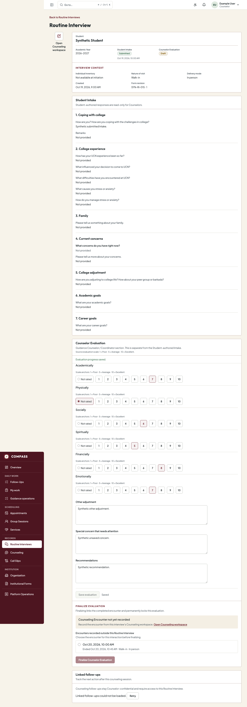 | 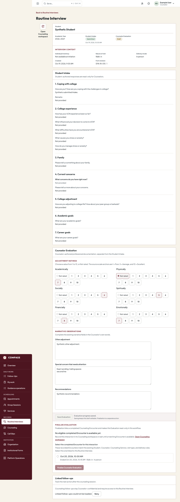 |
| Phone confirmed save | 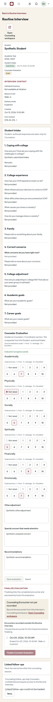 | 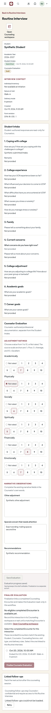 |
| Encounter already linked | 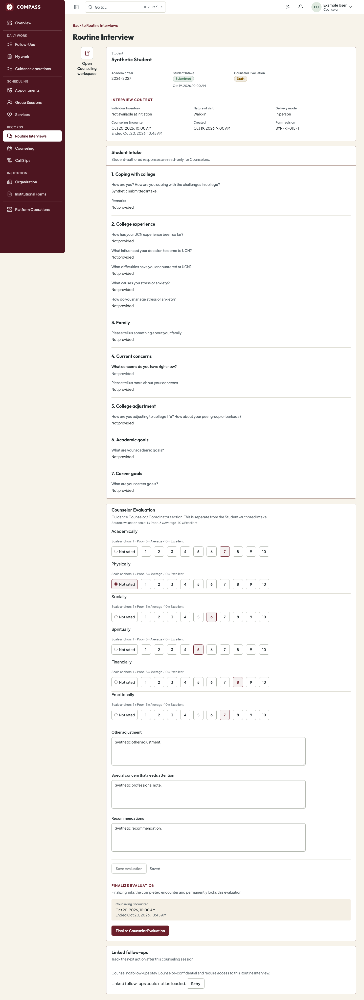 | 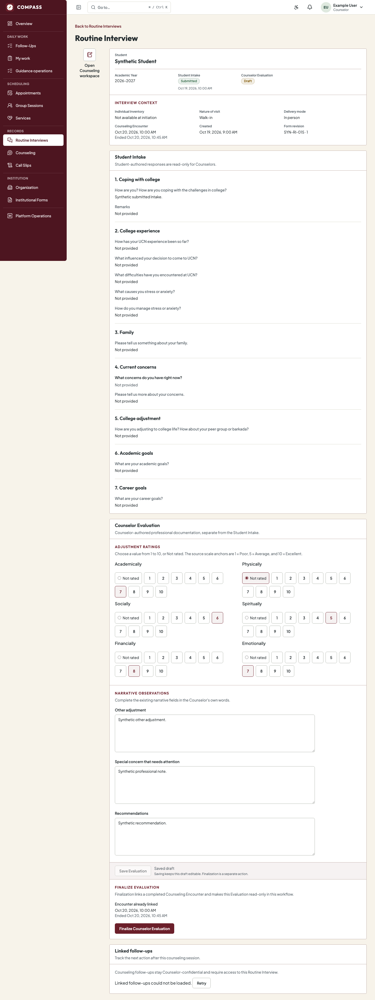 |
| Direct Encounter selected and ready | 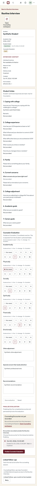 | 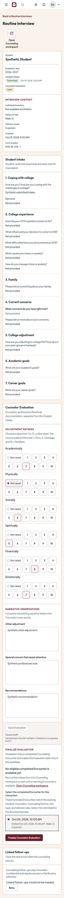 |
| No eligible Encounter | 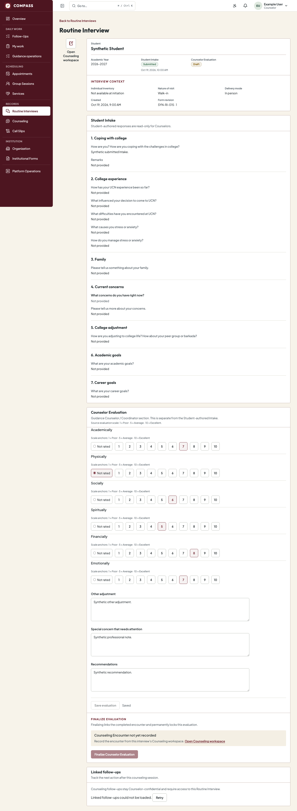 | 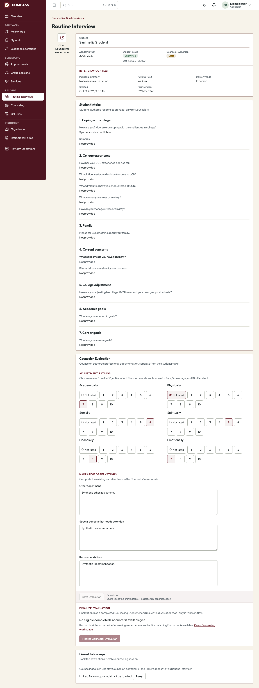 |
| Finalization confirmation | 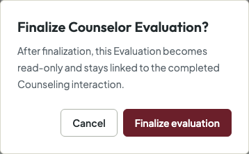 | 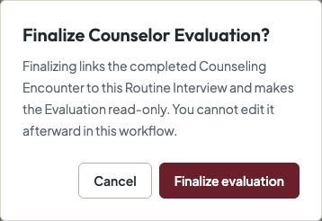 |
| Finalized read-only Evaluation | 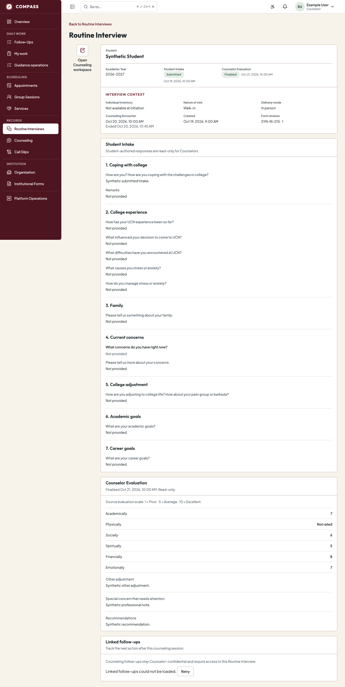 | 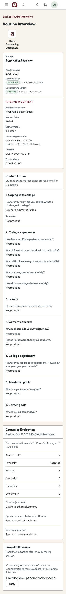 |

Visual review found the after layout separates adjustment ratings, narrative observations, save progress, and finalization without duplicating card frames. The rating scale is explained once and remains programmatically attached to each radio group. On mobile the controls wrap and the finalization section follows the editable Evaluation. The screenshots demonstrate presentation only; they do not imply institutional approval.
