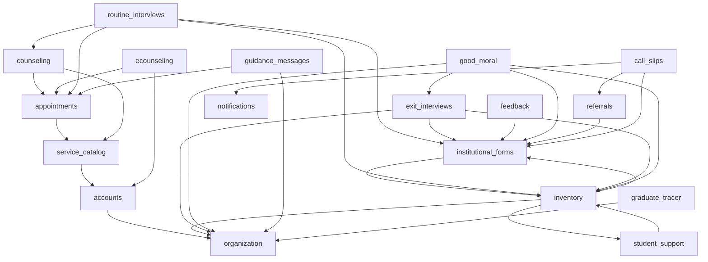

# COMPASS-CANON-1 — Database Migration Graph & Consolidation Plan

## 1. Migration Inventory Overview

As of baseline SHA `d353108d1f757386b9020c4d1297e081258d2e4e`:
- **Django Apps with Migrations:** 27 apps
- **Numbered Migration Files:** 102 files
- **Frozen Helper Modules (`_*_v1.py`):** 8 files
- **Total Tracked Migration Files:** 110 files
- **Custom PostgreSQL Triggers:** 0
- **`RunSQL` Operations:** 0
- **Merge Migrations:** 1 (`good_moral/0005_merge_20261005_0419.py`)
- **`RunPython` Operations:** 36 numbered migrations contain `RunPython` operations (16 are two-phase encryption backfill/verification operations with table locks; 6 are legacy form family/revision seeding; 4 are legacy model deletion checks; 10 are historical schema backfills/renames).

---

## 2. Complete Inventory by Application

| # | Django App | Numbered Migrations | Frozen Helper Modules | Key Operations & Characteristics |
|---|---|---:|---:|---|
| 1 | `accounts` | 8 | 1 (`_account_profile_confidential_content_v1.py`) | `0003` backfills lifecycle status; `0006` renames capabilities; `0007`/`0008` two-phase encryption with table locks |
| 2 | `announcements` | 2 | 0 | `0001` initial; `0002` alters audience enum |
| 3 | `appointments` | 3 | 0 | `0002` lifecycle completion; `0003` backfills service name snapshot |
| 4 | `assessment_records` | 1 | 0 | `0001_initial.py` (Ciphertext-only and Fernet-encrypted from day 1) |
| 5 | `audit` | 3 | 0 | `0002` alters metadata JSONField; `0003` relaxes action code regex |
| 6 | `authentication` | 2 | 0 | `0001` TOTP & sessions; `0002` email change requests |
| 7 | `availability` | 1 | 0 | `0001_initial.py` |
| 8 | `call_slips` | 3 | 0 | `0002` void and reissue; `0003` backfills issuance mode |
| 9 | `counseling` | 5 | 1 (`_shared_summary_content_v1.py`) | `0003` backfills service name snapshot; `0004`/`0005` two-phase encryption with table locks |
| 10 | `documents` | 2 | 0 | `0001` creates `DocumentBrandingProfile`; `0002` verifies and deletes model (App now has 0 models!) |
| 11 | `ecounseling` | 6 | 0 | `0002` consent capture; `0003` artifact disposed at; `0004` artifact model; `0005` capture reconciliation; `0006` webhook provenance |
| 12 | `exit_interviews` | 6 | 1 (`_exit_interview_confidential_content_v1.py`) | `0002` opportunity model; `0003`/`0004` two-phase encryption; `0005` saved form revision; `0006` targets ciphertext |
| 13 | `feedback` | 4 | 1 (`_feedback_confidential_content_v1.py`) | `0002` opportunity model; `0003`/`0004` two-phase encryption with table locks |
| 14 | `good_moral` | 7 | 0 | `0002` cancellation; `0003` creation identity; `0004` exit interview linkage; `0004` shape removal; `0005` merge migration; `0006` initiation origin |
| 15 | `graduate_tracer` | 5 | 1 (`_graduate_tracer_confidential_content_v1.py`) | `0002` disposed participation model; `0003`/`0004` two-phase encryption; `0005` graduation classification |
| 16 | `guidance_messages` | 2 | 0 | `0001` initial (Ciphertext-only from day 1); `0002` message templates |
| 17 | `institutional_forms` | 7 | 0 | `0001` to `0007` seed legacy CNSC FormFamily/FormRevision rows via `RunPython` (superseded by `sync_institutional_forms`) |
| 18 | `inventory` | 8 | 1 (`_inventory_confidential_content_v1.py`) | `0002` academic context; `0003` profiling normalization; `0004` student support profile context; `0005` submission history & reopen; `0006`/`0007` two-phase encryption; `0008` targets ciphertext |
| 19 | `notifications` | 2 | 0 | `0001` initial; `0002` push subscriptions |
| 20 | `organization` | 3 | 0 | `0001` initial structure; `0002` academic year; `0003` college & program models |
| 21 | `platform_ops` | 1 | 0 | `0001_initial.py` |
| 22 | `privacy_governance` | 6 | 0 | `0001`/`0002` legacy models; `0003` drops processing/review/incident; `0004` drops retention policy; `0005` operational rules & cases; `0006` removes rules unique constraint |
| 23 | `referrals` | 4 | 1 (`_referral_confidential_content_v1.py`) | `0002` void provenance; `0003`/`0004` two-phase encryption with table locks |
| 24 | `resources` | 2 | 0 | `0001` initial; `0002` alters audience enum |
| 25 | `routine_interviews` | 4 | 1 (`_routine_content_v1.py`) | `0002`/`0003` two-phase encryption with table locks; `0004` backfills academic year and makes inventory FK optional |
| 26 | `service_catalog` | 4 | 0 | `0001` initial (creates dead `ServiceProviderRole`); `0002` cancellation cutoff; `0003` requires current inventory; `0004` appointment booking enabled & counselor provider |
| 27 | `student_support` | 1 | 0 | `0001_initial.py` (Copies legacy parent life status from inventory) |
| **Total** | **27 apps** | **102** | **8** | **110 files** |

---

## 3. Cross-App Dependency Graph & Architectural Choke Points

### Key Choke Points & Historical Anomalies:
1. **Bidirectional Dependency between `inventory` and `student_support`:**
   - `student_support.0001_initial` depends on `inventory.0003_inventory_profiling_normalization`.
   - `inventory.0004_student_support_profile_context` depends on `student_support.0001_initial`.
   - In a consolidated schema, `StudentSupportProfile` simply references `User` and `StudentInventory` directly without historical migration intertwining.
2. **Dead Tables Created and Deleted:**
   - `documents`: `0001` creates `DocumentBrandingProfile`, `0002` checks and deletes it. The app has no models left.
   - `privacy_governance`: `0001`/`0002` create `ProcessingActivity`, `PrivacyReview`, `PrivacyIncident`, `RetentionPolicy`; `0003`/`0004` check and drop all 4 tables.
   - `service_catalog`: `0001` creates `ServiceProviderRole`, which is dead code since ADR-089 (Counselor is the sole provider class).
3. **Two-Phase Encryption Churn:**
   - 8 separate apps (`accounts`, `counseling`, `exit_interviews`, `feedback`, `graduate_tracer`, `inventory`, `referrals`, `routine_interviews`) performed a two-phase rollout: `encrypt_*` (added nullable ciphertext and ran Python backfill) followed by `remove_plaintext_*` (locked tables, verified ciphertext, dropped plaintext, added check constraints).
   - In a clean initial migration, these models simply define `*_ciphertext` columns with `CheckConstraint` from the start.

---

## 4. Canonical Re-Baselining Strategy (`CANON-4`)

The owner has authorized a clean-slate rebuild of live-staging. This allows replacing the 102 historical migrations with **26 canonical initial migrations (`0001_initial.py`)** (and 0 migrations for `documents`, which has no models).

### Consolidation Target:
- **1 single `0001_initial.py` per app** containing the final, canonical model state.
- **Ciphertext columns only:** All encrypted models declare their `*_ciphertext` fields directly in `0001_initial.py` with their `CheckConstraint` invariants.
- **No dead models:** Omit `DocumentBrandingProfile`, `ProcessingActivity`, `PrivacyReview`, `PrivacyIncident`, `RetentionPolicy`, and `ServiceProviderRole`.
- **Zero data migrations:** Pure DDL schema. All reference data, canonical forms, and capabilities are seeded authoritatively by:
  1. `sync_identity_policy`
  2. `sync_canonical_services`
  3. `sync_institutional_forms`
  4. `sync_organization_catalog`

### Verification Protocol (Tests A through E):
Before any merge to the reset branch, the following 5 tests must be executed against disposable PostgreSQL databases:
- **Test A (Migration from Empty):** Run `python manage.py migrate` on an empty PostgreSQL database. Must succeed in a single pass with 0 warnings.
- **Test B (Schema Comparison):** Introspect the database produced by canonical `0001` migrations and compare table-by-table, column-by-column, and constraint-by-constraint against a database migrated through the full 102-migration history. Every active column, index, foreign key, and constraint must match exactly.
- **Test C (Idempotent Bootstrap):** Run the 4 synchronization commands (`sync_identity_policy`, `sync_canonical_services`, `sync_institutional_forms`, `sync_organization_catalog`) twice. Must succeed cleanly with 0 duplicate rows or constraint violations.
- **Test D (Seeder Execution):** Run `seed_demo_staging` on the initialized database. Must populate all 57 accounts and exercise all domain workflows cleanly.
- **Test E (Full Backend Pytest Regression):** Run the complete backend test suite against the consolidated database. 100% of non-migration tests must pass.
